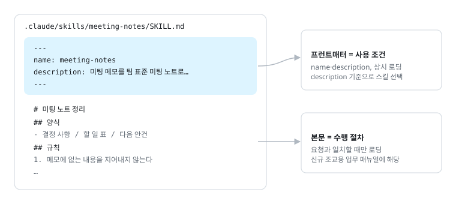
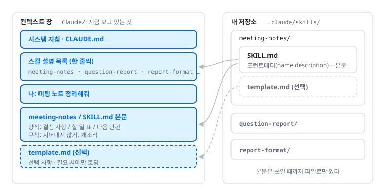

# 1. 스킬 만들기: 미팅 노트

> 이 파일은 [워크숍 실습 가이드북](https://yoonlee78.github.io/ai-agent-workshop-2026/#1) 1장과 같은 내용이다. 애니메이션과 최신 화면은 [웹 가이드북](https://yoonlee78.github.io/ai-agent-workshop-2026/#1)에서 볼 수 있다. 원본: [GUIDE.md](../GUIDE.md#1-스킬-만들기-미팅-노트)

## 스킬이란

**스킬**은 반복 업무용 매뉴얼 파일 하나다(`.claude/skills/<이름>/SKILL.md`). 위쪽 `---` 사이(프런트매터)에는 **언제 쓰는지**, 아래 본문에는 **어떻게 하는지**를 쓴다. 더 알아보기: [공식 문서: 스킬](https://code.claude.com/docs/ko/skills)



*그림: SKILL.md 해부도 · 프런트매터와 본문*

**별도 등록 불필요**: 등록 절차는 따로 없다. 폴더에 파일이 있으면 Claude Code가 열릴 때마다 자동으로 읽는다. 저장소의 `.claude/skills/`에 두면 그 저장소에서, 내 홈의 `~/.claude/skills/`에 두면 모든 프로젝트에서 쓴다. 스킬을 대신 만들어 주는 도우미(skill-creator)도 있지만 결과는 같은 파일이다.

**자동 호출 조건**: Claude는 평소에 스킬마다 이름과 description 한 줄만 들고 있다가, 내 말과 맞는 description이 있으면 그 스킬의 본문을 읽어 쓴다. 예를 들어 "미팅 노트 정리해줘"라고 하면 description에 "'미팅 노트 정리해줘'라고 할 때 사용"이라고 적힌 `meeting-notes`가 불린다. 그래서 description에는 **무엇을 하는지와 언제 쓰는지**를 함께 쓴다.



*그림: 스킬 로딩 3단계 · [애니메이션은 웹 가이드북에서 재생](https://yoonlee78.github.io/ai-agent-workshop-2026/#fig-skill)*

**호출과 수정**

| 작업 | Claude Code | Codex |
| --- | --- | --- |
| 스킬 목록 보기 | `/skills` | `/skills` |
| 직접 부르기 | `/meeting-notes 메모…` | `$meeting-notes 메모…` |
| 자동 호출 끄기 | 프런트매터에 `disable-model-invocation: true` | `agents/openai.yaml`에 `allow_implicit_invocation: false` |
| 고치기 | "meeting-notes 스킬 규칙을 …로 바꿔줘" | 같다 |

**스킬 목록**

```text
> /skills
  Skills
  ⎿ meeting-notes · project · 미팅 메모를 팀 표준 미팅 노트로 정리한다…
  ⎿ workshop-tutor · project · 워크숍 실습 자동 진행…
```

**직접 부르기**

```text
> /meeting-notes 금요일 미팅. 하늘 발표 연습, 다음주 화요일 리허설. 장소 미정
● Skill(meeting-notes)
  ⎿ 일시: 금요일(날짜 확인 필요) / 참석자: 확인 필요
  ⎿ 결정 사항: 1. 하늘 발표 리허설은 다음 주 화요일
  ⎿ 다음 미팅 안건: 리허설 장소
  ⎿ 담당자 미정 할 일 0개
```

**스킬 고치기**

```text
> meeting-notes 스킬 규칙에 "4. 마감이 없는 할 일은 표 맨 아래로 보낸다"를 추가해줘.
● Update(.claude/skills/meeting-notes/SKILL.md)
  ⎿ Updated with 1 addition
      22   3. 마지막 줄에 "담당자 미정 할 일 N개"처럼 빠진 정보를 요약한다.
      23 + 4. 마감이 없는 할 일은 표 맨 아래로 보낸다.
● 규칙 4번을 추가했습니다. 다음 미팅 노트부터 적용됩니다.
```

## 작업 창

모든 실습은 **`~/ai-agent-workshop-2026`에서 연 Claude Code 창 하나**(작업 창)에서 한다.[^layout] 직접 모드는 1-1에서 연다.

[^layout]: 파일은 두 곳에 나눠 둔다. 스킬과 서브에이전트는 저장소 맨 위 `.claude/` 한 곳에 모아, 작업 창 하나에서 장과 상관없이 꺼내 쓴다(예: 3장의 `meeting-scribe`가 1장에서 만든 `meeting-notes` 스킬을 쓴다). 미팅 메모, 핸드북, 미팅 노트, 리포트 같은 자료와 결과물은 `03-subagents/`, `05-report/` 같은 장 폴더에 둔다.
[^0b]: 자동 진행이 시작되지 않으면 `/workshop-tutor 1장부터`로 직접 부른다. 이후로는 "다음", "3-2 하자"처럼 말하면 된다. 에이전트가 파일을 만들고 명령을 실행해 주지만, 만든 스킬·에이전트를 시험하는 질문은 직접 입력한다.

## 1-1. 내 저장소 연결하기

**목표**: 실습 저장소와 개인 GitHub 비공개 저장소의 연결

터미널(Claude Code 밖)에 붙여 넣는다.

```bash
cd ~/ai-agent-workshop-2026
git pull
git remote remove origin
gh repo create ai-agent-workshop-2026 --private --source . --remote origin
claude
```

Codex 사용자는 마지막 줄 `claude` 대신 `codex`를 입력한다. 아래 프롬프트의 `CLAUDE.md`도 `AGENTS.md`로 바꿔서 붙여 넣는다. 내용은 같다([부록 B](../GUIDE.md#부록-b--claude-구독-없이-하기-codex--openrouter)).

"이 폴더를 신뢰하나요?" → **Yes**. 이제 `CLAUDE.md`를 만든다. Claude가 이 저장소에서 일할 때마다 먼저 읽는 규칙 파일이다([공식 문서: CLAUDE.md](https://code.claude.com/docs/ko/memory)). 작업 창에:

````text
이 저장소 루트에 CLAUDE.md 를 아래 내용 그대로 만들어줘.

# ai-agent-workshop-2026
워크숍 실습 저장소. 장마다 폴더가 있고(01-skill ~ 05-report), 스킬과 서브에이전트는 루트 .claude/ 에 만든다.
- 연구실 핸드북은 03-subagents/handbook/ 에 있다. 독자는 이번 학기에 들어온 신입이다. 전문용어는 처음 나올 때 한 줄로 풀어 쓴다.
- 사실이 확인되지 않은 내용(계정 담당자, 장비 위치 등)은 "TODO: 팀장 확인"으로 남긴다.
- 미팅이 끝나면 meeting-notes 양식으로 03-subagents/meetings/YYYY-MM-DD.md 에 저장한다. 같은 날 두 번째 미팅은 YYYY-MM-DD-2.md.
- 새 멤버의 질문은 onboarding-buddy 서브에이전트에게 맡긴다.
- 루트의 README.md, GUIDE.md 는 워크숍 가이드북이다. 핸드북 질문의 근거로 쓰지 않는다.
````

**확인**

- `git remote -v`에 내 아이디의 `ai-agent-workshop-2026`만 보인다
- `gh repo view --web`으로 내 비공개 저장소가 열린다 (아직 비어 있다. 첫 push는 3-3)
- 폴더에 `CLAUDE.md`가 있다 (Codex 사용자는 `AGENTS.md`)[^1-1]

**내 저장소가 연결된 화면**

```text
이름@컴퓨터 ~ % cd ~/ai-agent-workshop-2026
이름@컴퓨터 ai-agent-workshop-2026 % git pull
Already up to date.
이름@컴퓨터 ai-agent-workshop-2026 % git remote remove origin
이름@컴퓨터 ai-agent-workshop-2026 % gh repo create ai-agent-workshop-2026 --private --source . --remote origin
✓ Created repository <아이디>/ai-agent-workshop-2026 on GitHub
  https://github.com/<아이디>/ai-agent-workshop-2026
✓ Added remote https://github.com/<아이디>/ai-agent-workshop-2026.git
```

## 1-2. 미팅 노트 스킬 `meeting-notes`

**목표**: 미팅 메모를 정해진 양식(결정 사항, 할 일, 담당자, 마감)으로 정리하는 스킬 작성

````text
.claude/skills/meeting-notes/SKILL.md 를 아래 내용 그대로 만들어줘.

---
name: meeting-notes
description: 미팅 메모를 팀 표준 미팅 노트로 정리한다. 사용자가 미팅 메모를 붙여 넣거나 "미팅 노트 정리해줘"라고 할 때 사용.
---

# 미팅 노트 정리

입력된 메모를 아래 양식으로 정리한다.

## 양식
- 일시 / 참석자: 메모에 없으면 "확인 필요"
- 결정 사항: 번호 목록, 한 줄씩
- 할 일: 표 (할 일 | 담당자 | 마감), 없는 칸은 "미정"
- 다음 미팅 안건: 결론이 안 난 이야기

## 규칙
1. 메모에 없는 내용을 지어내지 않는다.
2. 간결한 개조식으로 쓴다.
3. 마지막 줄에 "담당자 미정 할 일 N개"처럼 빠진 정보를 요약한다.
````

**Codex 사용자**는 위 상자 대신 아래 상자를 붙여 넣는다. Codex는 `.agents/skills/`에서 스킬을 찾는다.

````text
.agents/skills/meeting-notes/SKILL.md 를 아래 내용 그대로 만들어줘.

---
name: meeting-notes
description: 미팅 메모를 팀 표준 미팅 노트로 정리한다. 사용자가 미팅 메모를 붙여 넣거나 "미팅 노트 정리해줘"라고 할 때 사용.
---

# 미팅 노트 정리

입력된 메모를 아래 양식으로 정리한다.

## 양식
- 일시 / 참석자: 메모에 없으면 "확인 필요"
- 결정 사항: 번호 목록, 한 줄씩
- 할 일: 표 (할 일 | 담당자 | 마감), 없는 칸은 "미정"
- 다음 미팅 안건: 결론이 안 난 이야기

## 규칙
1. 메모에 없는 내용을 지어내지 않는다.
2. 간결한 개조식으로 쓴다.
3. 마지막 줄에 "담당자 미정 할 일 N개"처럼 빠진 정보를 요약한다.
````

시험:

```text
미팅 노트 정리해줘: 오늘 민수 지영 참석, 서버 계정은 지영이 금요일까지 만들기로, 세미나 요일은 아직 못 정함
```

**확인**: 결정 사항, 할 일 표, 다음 안건, 마지막 줄 "담당자 미정 할 일 N개"가 나온다. 메모에 없는 날짜나 사람은 없다.[^1-2]

**.claude/skills/meeting-notes/SKILL.md**

```text
---
name: meeting-notes
description: 미팅 메모를 팀 표준 미팅 노트로 정리한다. 사용자가 미팅 메모를 붙여 넣거나 "미팅 노트 정리해줘"라고 할 때 사용.
---

# 미팅 노트 정리

입력된 메모를 아래 양식으로 정리한다.
...
```

**스킬이 쓰이는 모습**

```text
> 미팅 노트 정리해줘: 오늘 민수 지영 참석, 서버 계정은 지영이 금요일까지 만들기로, 세미나 요일은 아직 못 정함
● Skill(meeting-notes)
● 미팅 노트로 정리했습니다.
  ⎿ 일시: 확인 필요 / 참석자: 민수, 지영
  ⎿ 결정 사항: 1. 서버 계정은 지영이 만든다
  ⎿ 할 일 | 서버 계정 생성 | 지영 | 금요일
  ⎿ 다음 미팅 안건: 세미나 요일
  ⎿ 담당자 미정 할 일 0개
```

## 1-3. 스킬 호출과 수정 · 선택

시간이 남으면 1-2에서 만든 `meeting-notes`로 해 본다. 화면 예시는 위 "호출과 수정" 참고.

**① 목록 보기**

```text
/skills
```

**② 직접 부르기**: 말이 애매해서 자동으로 안 불릴 때 쓴다.

```text
/meeting-notes 금요일 미팅. 하늘 발표 연습, 다음주 화요일 리허설. 장소 미정
```

**③ 고치기**: 파일을 직접 열지 않고 말로 고친다.

```text
meeting-notes 스킬 규칙에 "4. 마감이 없는 할 일은 표 맨 아래로 보낸다"를 추가해줘.
```

**④ 재시험**: 1-2의 시험 문장을 다시 보내 바뀐 규칙이 반영됐는지 본다. 재시작은 필요 없다.

**확인**: `/skills`에 `meeting-notes`가 보이고, 직접 부르기에서 `Skill(meeting-notes)` 줄이 나온다. 고친 규칙이 다음 결과에 반영된다.

[^1-1]: `git pull`은 강사가 고친 최신 자료를 받는 것이라 연결을 바꾸기 전에 한다. `remove origin`은 강사 저장소와의 연결만 끊는다(파일은 그대로). `Name already exists`: 마지막 줄의 이름을 `ai-agent-workshop-2026-1019`처럼 바꿔 다시 실행한다. gh 오류: README의 E 환경 점검. 시간이 없으면 `gh repo create` 줄만 빼고 진행해도 5번까지 할 수 있다(push만 못 한다).
[^1-2]: 스킬이 안 쓰이면 `/skills`로 `meeting-notes`가 있는지 본다(1-3 참고). 없으면 `~/ai-agent-workshop-2026`이 아닌 곳에서 연 것이다. 미팅 노트를 파일로 남기는 일은 3-1에서 한다.
