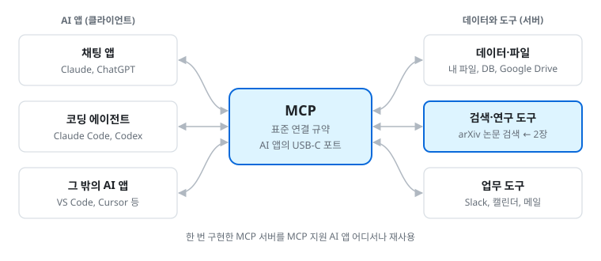
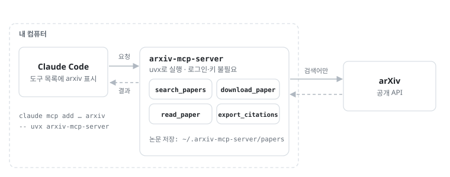
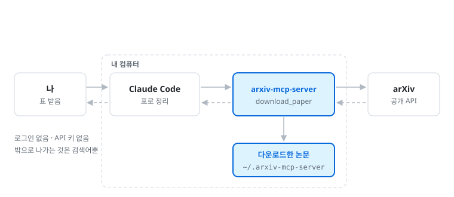
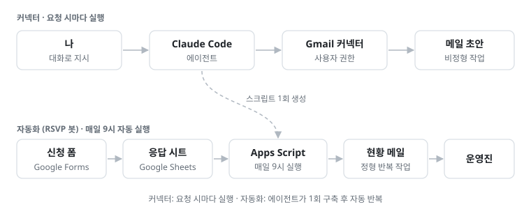

# 2. MCP 연결: arXiv 논문 검색

> 이 파일은 [실습 안내서](https://yoonlee78.github.io/ai-agent-workshop-2026/#2-mcp-arxiv) 2장과 같은 내용이다. 애니메이션과 최신 화면은 [웹 안내서](https://yoonlee78.github.io/ai-agent-workshop-2026/#2-mcp-arxiv)에서 볼 수 있다. 원본: [GUIDE.md](../GUIDE.md#2-mcp-연결-arxiv-논문-검색)

## MCP란

**MCP**(Model Context Protocol)는 AI 앱과 외부 데이터·도구(파일, 데이터베이스, 검색 등)를 연결하는 공개 표준 규격이다. 흔히 **AI 앱의 USB-C 포트**에 비유한다. 기기마다 전용 케이블이 필요 없듯, 도구를 MCP 서버로 한 번 만들어 두면 MCP를 지원하는 어느 AI 앱에서든 꽂아 쓸 수 있다. 오늘은 arXiv 논문 검색 서버를 꽂는다.



*그림: MCP란 · AI 앱과 데이터·도구 사이의 표준 연결*

더 알아보기: [공식 문서: MCP 소개](https://modelcontextprotocol.io/docs/2026-07-28/getting-started/intro) [공식 문서: Claude Code에서 MCP 쓰기](https://code.claude.com/docs/ko/mcp)

**사용 이유**: 에이전트는 기본적으로 내 컴퓨터의 파일과 학습한 지식만 안다. MCP를 붙이면 바깥 서비스의 지금 데이터를 읽고, 그 서비스에서 직접 일할 수 있다. 내가 복사해 붙여 넣던 일을 에이전트가 대신한다.

| 분야 | 예 | 연구실 활용 예 |
| --- | --- | --- |
| 문헌 | arXiv 검색 서버 | 최근 논문 찾기, 내려받아 요약하기 (2장) |
| 업무 도구 | Gmail, Google Drive·Calendar, Slack, Notion | 메일 초안, 공유 문서 찾기, 빈 시간 찾기 (2-3) |
| 코드·협업 | GitHub | 이슈·PR 보기, 저장소 관리 |
| 데이터 | 데이터베이스, 스프레드시트 | 실험 데이터를 직접 조회해 표·그래프 만들기 |
| 웹 | 브라우저 자동화 | 웹페이지를 열어 정보 모으기 |

**웹 검색과의 차이**: 일회성 검색은 웹 검색으로 충분하다. 같은 작업을 정확하게 반복할 때는 MCP가 유리하다.

- 웹 검색은 웹페이지 조각을 돌려준다. arXiv MCP는 arXiv가 주는 그대로(번호, 저자, 날짜, 분야)를 돌려줘서 논문 정보의 오생성 가능성이 줄어든다.
- 검색에서 끝나지 않는다. 논문을 내려받아 절별로 읽고, BibTeX 인용을 뽑고, 관심 주제의 새 논문을 확인하는 데까지 이어진다.
- 한 번 붙여 두면 Claude Code, Codex 등 다른 AI 앱에서도 같은 도구를 쓴다.

MCP를 붙이는 것은 그 서비스에 대한 권한을 에이전트에게 주는 일이다. 무엇이 밖으로 나가는지, 읽기만 하는지 쓰기도 하는지를 보고 고른다.



*그림: MCP 구조 · 질의와 응답의 경로*


*그림: MCP 호출 한 번 · [애니메이션은 웹 안내서에서 재생](https://yoonlee78.github.io/ai-agent-workshop-2026/#fig-mcp)*

## 2-1. arXiv MCP 연결하기

**목표**: arXiv 논문 검색용 MCP 서버 연결[^mcp]

`/exit`로 나가서 **터미널**에 붙여 넣는다.[^mcpcmd]

```bash
cd ~/ai-agent-workshop-2026
claude mcp add --transport stdio --scope project arxiv -- uvx arxiv-mcp-server
claude mcp list
```

Claude Code를 다시 연다(MCP는 시작할 때 연결된다).

```bash
claude --continue
```

`New MCP server found in .mcp.json: arxiv`가 나타나면 **Use this and all future MCP servers in this project**를 고른다.

**Codex 사용자**는 위 두 상자 대신 아래를 쓴다. `/quit`로 나가서 터미널에 붙여 넣는다. Codex는 MCP를 저장소가 아니라 내 계정 설정(`~/.codex/config.toml`)에 저장하므로 `.mcp.json`은 생기지 않는다.

```bash
cd ~/ai-agent-workshop-2026
codex mcp add arxiv -- uvx arxiv-mcp-server
codex mcp list
```

Codex를 다시 열고, `/mcp`에서 `arxiv: connected`를 확인한다.

```bash
codex resume --last
```

**확인**

- `claude mcp list`에 `arxiv ... ✓ Connected`가 보인다
- 저장소에 `.mcp.json`이 생겼다
- Claude Code 안에서 `/mcp`를 치면 arxiv와 도구 목록(`search_papers` 등)이 보인다

## 2-2. 논문 검색

**목표**: MCP 도구를 활용한 논문 검색과 읽기

하나씩 보낸다.

```text
arxiv에서 "large language model agents psychology research" 최근 논문 5편 찾아서 제목, 저자, 한 줄 요약을 표로 보여줘
```

```text
그중 첫 번째 논문을 내려받아서 방법론 부분만 요약해줘
```

**확인**: `arxiv - search_papers (MCP)` 호출 줄이 보이고, arXiv 번호가 달린 표가 나온다.[^2]

**논문 검색 결과**

```text
> arxiv에서 "large language model agents psychology research" 최근 논문 5편 찾아서 제목, 저자, 한 줄 요약을 표로 보여줘
● arxiv - search_papers (MCP)(query: "large language model agents psychology research", max_results: 5)
  ⎿ Found 5 papers
● 최근 논문 5편입니다.
  ⎿ | arXiv | 제목 | 저자 | 한 줄 요약 |
  ⎿ | 2501.0xxxx | (논문 제목 1) | Kim et al. | LLM 에이전트로 실험 참가자 응답을 모사 |
  ⎿ | 2502.1xxxx | (논문 제목 2) | Lee et al. | 상담 대화 에이전트의 공감 반응 평가 |
  ⎿ | ... (5행)
```

## 2-3. 커넥터 활용 · 선택

수업 시간에는 같이 하지 않는다. 필요한 사람만 수업 뒤에 각자 해 본다. Codex나 Windows에서는 Gmail 같은 구글 서비스 연결이 되지 않는 경우가 있다.

**로그인 기반 커넥터**

arXiv처럼 서버를 직접 붙이는 방법 말고도, Claude와 Codex는 자주 쓰는 서비스를 커넥터(Codex에서는 플러그인)로 제공한다.

| 서비스 | 연구실 활용 예 | Claude | Codex |
| --- | --- | --- | --- |
| Gmail | 메일 찾기·요약, 답장 초안 | 커넥터 | 플러그인 |
| Google Calendar | 미팅 일정 잡기, 빈 시간 찾기 | 커넥터 | — |
| Google Drive (Docs·Sheets·Slides) | 공유 문서 찾기, 스프레드시트 읽기·만들기 | 커넥터 | 플러그인 |
| Slack | 채널 대화 찾기·요약 | 커넥터 | 플러그인 |
| GitHub | 이슈·PR 보기 | 커넥터 | 연동 |
| 그 밖에 (Notion, Figma 등) | — | 커넥터 목록에서 찾기 | `/plugins`에서 찾기 |
| 목록에 없는 것 (Google Cloud, 데이터베이스 등) | — | 그 서비스가 제공하는 MCP 서버를 `claude mcp add` | `codex mcp add` |

연결은 Claude는 [claude.ai/customize/connectors](https://claude.ai/customize/connectors)에서, Codex는 `/plugins`에서 한다. 연결하면 Claude Code의 `/mcp`에 `claude.ai` 이름을 달고 자동으로 보인다. 더 알아보기: [공식 문서: Codex 플러그인](https://learn.chatgpt.com/docs/plugins)

**claude.ai · 커넥터 설정**

```text
커넥터
  Gmail            메일 검색·읽기·초안            [연결됨 ✓]
  Google Calendar  일정 보기·만들기               [연결]
  Google Drive     문서·스프레드시트 찾기·만들기    [연결]
  Slack            채널 검색·요약                 [연결]
  + 커넥터 둘러보기
```

**/mcp 목록**

```text
> /mcp
  Manage MCP servers
  ❯ arxiv · project · ✓ connected · 4 tools
    claude.ai Gmail · ✓ connected · 12 tools
    claude.ai Google Calendar · ✓ connected · 9 tools
    claude.ai Google Drive · △ needs authentication
```

**Gmail 초안 만들기**

```text
> 03-subagents/meetings/ 의 가장 최근 미팅 노트를 읽고, 다음 미팅 안내 메일 초안을 Gmail에 만들어줘. … 보내지 말고 초안만 만들어.
● Read(03-subagents/meetings/2026-10-05.md)
● claude.ai Gmail - create_draft (MCP)(subject: "[미팅] 다음 미팅 안내", to: "")

  Do you want to proceed?
  ❯ 1. Yes
    2. Yes, and don't ask again for claude.ai Gmail - create_draft
    3. No, and tell Claude what to do differently

> 1
  ⎿ Draft created
● Gmail 임시보관함에 초안을 만들었습니다. 받는 사람을 넣고 직접 확인한 뒤 보내세요.
```

**활용 사례: RSVP 봇**



*그림: 커넥터 기반 자동화 · RSVP 봇의 신청 현황 메일 처리 흐름*

**연결 전 유의 사항**

- 권한을 어떻게 주느냐에 따라 에이전트가 메일을 읽기만 할 수도, 내 이름으로 실제 메일을 보낼 수도 있다. 무엇을 연결하고 어디까지 허락할지는 본인이 판단하고 책임진다.
- 커넥터는 내 계정 권한 그대로 메일·문서에 접근한다. 보내기·삭제처럼 바깥에 영향을 주는 일은 허락 창에서 매번 확인한다. "don't ask again"은 읽기 도구에만 쓴다.
- 학교·기관 계정은 관리자가 막아 둔 경우가 있다. 이때는 개인 계정으로 먼저 시험한다.
- 참여자 정보가 든 메일함이나 드라이브는 연결하지 않는다.

**① claude.ai에서 연결** (브라우저)

1. [claude.ai/customize/connectors](https://claude.ai/customize/connectors)를 연다.
2. **Gmail** 옆 **연결** → Google 계정 선택 → 권한 **허용**. Calendar, Drive도 같은 방법이다.

**② Claude Code에서 `/mcp`로 확인**

작업 창에서 `/mcp`를 입력한다. claude.ai에서 연결한 것이 `claude.ai` 이름을 달고 자동으로 보인다. 따로 설치하지 않는다. 목록에 없으면 `/exit` 후 `claude --continue`로 다시 연다.

```text
/mcp
```

연결 후 채널·메일이 보이지 않으면, 다른 계정이나 워크스페이스에 연결된 경우가 많다. claude.ai에서 연결을 해제하고 다시 연결한다. Slack은 허용 화면 오른쪽 위에서 워크스페이스를 고른다. 다시 연결한 뒤에는 Claude Code를 다시 연다. 커넥터는 **내 계정**으로 움직이므로 Claude를 채널에 초대할 필요는 없다(4장의 Claude 앱과 다르다).

**③ 읽기 기능부터 시험**

처음에는 바꾸는 일 없이 읽기만 시킨다. 도구를 처음 쓸 때 Claude Code가 허락을 묻는다.

```text
Gmail에서 최근 일주일 동안 받은 메일 중 "세미나"가 들어간 메일 3개를 찾아서 보낸 사람과 제목만 표로 보여줘. 본문은 옮기지 마.
```

```text
내 Google Calendar에서 다음 주 화요일~목요일 오후에 1시간 비는 시간을 찾아줘. 일정은 만들지 마.
```

```text
Google Drive에서 "핸드북"이 들어간 문서를 찾아 제목과 마지막 수정일만 보여줘.
```

**④ 미팅 노트 기반 메일 초안 작성**

3장에서 만든 미팅 노트로 미팅 안내 메일 **초안**을 만든다. 보내지는 않는다.

```text
03-subagents/meetings/ 의 가장 최근 미팅 노트를 읽고, 다음 미팅 안내 메일 초안을 Gmail에 만들어줘.
- 받는 사람은 비워 둬
- 제목: [미팅] 다음 미팅 안내
- 내용: 결정 사항 3줄 요약, 담당자별 할 일 표, 다음 미팅 안건
- 맨 위에 "[AI 에이전트가 작성한 초안]"이라고 표시해
보내지 말고 초안만 만들어.
```

**확인**: Gmail 웹의 **임시보관함**에 초안이 있다. 받는 사람이 비어 있고, 내용이 미팅 노트와 맞다. 보내기는 내가 직접 한다.

**⑤ Slack 질문에 대한 온보딩 버디 답변** (3장 이후)

MCP 커넥터와 3장 서브에이전트를 한 흐름으로 잇는다. 테스트용 채널을 하나 만들고, 신입 역할로 질문을 올린다.

```text
안녕하세요, 이번 주에 들어온 인턴입니다! 연구윤리 교육은 언제까지 신청해야 하나요? 누구한테 신청하면 되는지도 궁금해요
```

그다음 작업 창에:

```text
Slack #<테스트 채널> 의 가장 최근 질문을 읽고 onboarding-buddy에게 물어봐. 버디의 답을 그 질문의 스레드에 초안으로 달아줘.
- 맨 위에 "🤖 [온보딩 버디 · AI 에이전트가 작성한 답]"이라고 표시해
- 근거 파일:줄은 그대로 남겨
- 보내지 말고 초안만 만들어
```

**테스트 채널 스레드**

```text
신입: 안녕하세요, 이번 주에 들어온 인턴입니다! 연구윤리 교육은 언제까지 신청해야 하나요? 누구한테 신청하면 되는지도 궁금해요
나: 🤖 [온보딩 버디 · AI 에이전트가 작성한 답]
  • 누구에게: 연구윤리 교육 담당은 최안전 님이에요. (확인 전)
  • 언제까지: 신청 기한은 문서에 없음, 팀장 확인 필요
  • 어떻게: 신청 방법도 문서에 없음, 팀장 확인 필요
  📝 핸드북에 추가할 문장 제안: "연구윤리 교육은 입실 후 ○주 이내 최안전에게 ○○로 신청한다."
  근거: 03-subagents/handbook/01-onboarding.md:3, :12, :40
  이 답은 Claude Code의 온보딩 버디가 연구실 핸드북만 근거로 작성했습니다.
```

**확인**: 스레드에 초안이 생겼다. 작성자 표시가 맨 위에 있고, 기한은 지어내지 않고 "문서에 없음, 팀장 확인 필요"다. 근거 줄 하나를 직접 열어 대조한 뒤 보낸다.

커넥터로 올리는 글은 **내 이름으로** 올라간다. 에이전트가 쓴 글에는 항상 작성자 표시를 붙여서, 읽는 사람이 내가 직접 쓴 글로 오해하지 않게 한다.

**Codex에서는**: `codex`에서 `/plugins` → **Gmail** 설치 → 로그인 → 새 대화. 프롬프트는 같다. `@`를 치면 플러그인을 직접 고를 수 있다.

[^mcp]: [arxiv-mcp-server](https://github.com/blazickjp/arxiv-mcp-server)는 로그인도 API 키도 필요 없다. 바깥으로는 검색어만 나가고, 논문은 `~/.arxiv-mcp-server/papers`에 저장된다. MCP 선택 기준은 사용자 규모, 로그인·키 필요 여부, 외부 전송 데이터다.
[^mcpcmd]: `arxiv`는 서버 이름. `--scope project`는 저장소의 `.mcp.json`에 저장해 저장소를 받는 사람 모두가 같은 MCP를 쓰게 한다. `--` 뒤는 서버를 켜는 명령이다. 처음에는 내려받느라 수십 초 걸릴 수 있다.
[^2]: "이 도구를 쓸까요?"가 나타나면 허용한다. `uvx: command not found`: README의 E 환경 점검대로 uv를 설치한 뒤 터미널을 새로 연다. `/mcp`에 arxiv가 없음: `/exit` 후 `claude --continue`. `Failed to connect`: 잠시 뒤 `claude mcp list`를 다시 본다.
