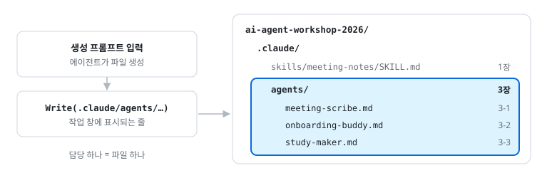
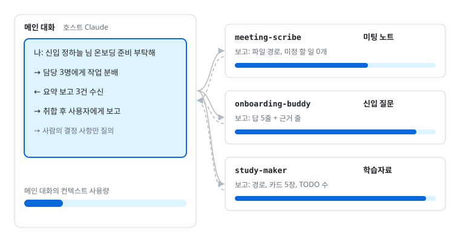
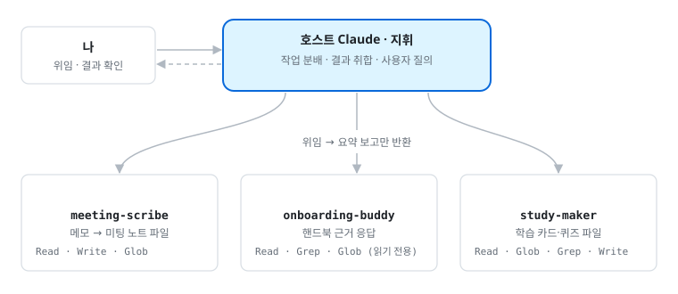

# 3. 서브에이전트 3개: 신입 온보딩

> 이 파일은 [실습 안내서](https://yoonlee78.github.io/ai-agent-workshop-2026/#3-3) 3장과 같은 내용이다. 애니메이션과 최신 화면은 [웹 안내서](https://yoonlee78.github.io/ai-agent-workshop-2026/#3-3)에서 볼 수 있다. 원본: [GUIDE.md](../GUIDE.md#3-서브에이전트-3개-신입-온보딩)

**서브에이전트**는 일을 맡기면 따로 처리하고 결과만 짧게 보고하는 담당자다. 더 알아보기: [공식 문서: 서브에이전트](https://code.claude.com/docs/ko/sub-agents)[^sub]

**저장 위치 `.claude/agents/`**: 담당 하나당 파일 하나. 1장 스킬과 같은 `.claude/` 폴더 안에 생성된다(Codex는 `.codex/agents/<이름>.toml`).

**Codex 사용자**: 3장의 담당 3개는 각 절의 Codex 상자를 쓴다. 그 밖의 서브에이전트(5-4 `ethics-checker`, 9-2 `interview-transcriber`)는 아래 상자 끝에 해당 상자 내용을 붙여 변환한다. Codex 에이전트 파일에는 `tools` 제한이 없으므로 읽기 전용 담당은 "파일을 고치지 않는다"는 지시로만 제한되며, 결과 확인 시 `git status`로 파일 변경 여부를 점검한다.

```text
아래 Claude Code 서브에이전트를 Codex 형식으로 바꿔서 .codex/agents/<이름>.toml 로 만들어줘.
name, description은 그대로, 본문은 developer_instructions에 넣어. tools·model 줄은 빼고,
skills 줄이 있으면 "<스킬 이름> 스킬 양식을 따른다"를 developer_instructions 첫 줄에 넣어.
(여기에 안내서 상자 내용을 붙여 넣는다)
```



*그림: 서브에이전트 파일 위치 · 3장을 마친 뒤의 .claude/ 폴더*



*그림: 서브에이전트 위임 · [애니메이션은 웹 안내서에서 재생](https://yoonlee78.github.io/ai-agent-workshop-2026/#fig-subagent)*

시나리오: 신입(인턴) 정하늘 님 합류. ① 미팅 노트 담당이 첫 미팅을 기록 → ② 온보딩 버디가 핸드북으로 안내 → ③ 학습자료 담당이 첫 주 학습 카드를 만든다.[^scenario]



*그림: 담당 3명의 역할 · 담당별 도구 권한*

## 3-1. 미팅 노트 담당 `meeting-scribe`

**목표**: 미팅 메모 정리·저장 담당 서브에이전트 작성

````text
.claude/agents/meeting-scribe.md 를 아래 내용 그대로 만들어줘.

---
name: meeting-scribe
description: 미팅 메모를 meeting-notes 양식의 미팅 노트로 정리해 03-subagents/meetings/ 에 파일로 저장한다. 미팅 메모, 미팅 노트 저장 요청에 사용.
tools: Read, Write, Glob
model: sonnet
skills: [meeting-notes]
---

너는 이 연구실의 미팅 노트 담당이다. 메모를 받으면:
1. meeting-notes 스킬 양식으로 정리한다. 메모에 없는 내용은 지어내지 않는다.
2. 03-subagents/meetings/YYYY-MM-DD.md 로 저장한다. 날짜는 메모의 미팅 날짜를 쓰고, 없으면 오늘 날짜를 쓴다. 같은 이름 파일이 있으면 -2, -3을 붙인다.
3. 끝나면 저장한 파일 경로와 "담당자 미정 할 일 N개"만 보고한다.
````

**Codex 사용자**는 위 상자 대신 아래 상자를 붙여 넣는다. Codex는 `.codex/agents/`에서 에이전트를 찾는다. 만든 뒤 `/quit`, `codex resume --last`로 다시 연다.

````text
.codex/agents/meeting-scribe.toml 을 아래 내용 그대로 만들어줘.

name = "meeting-scribe"
description = "미팅 메모를 meeting-notes 양식의 미팅 노트로 정리해 03-subagents/meetings/ 에 파일로 저장한다. 미팅 메모, 미팅 노트 저장 요청에 사용."
developer_instructions = """
meeting-notes 스킬 양식을 따른다.
너는 이 연구실의 미팅 노트 담당이다. 메모를 받으면:
1. meeting-notes 스킬 양식으로 정리한다. 메모에 없는 내용은 지어내지 않는다.
2. 03-subagents/meetings/YYYY-MM-DD.md 로 저장한다. 날짜는 메모의 미팅 날짜를 쓰고, 없으면 오늘 날짜를 쓴다. 같은 이름 파일이 있으면 -2, -3을 붙인다.
3. 끝나면 저장한 파일 경로와 "담당자 미정 할 일 N개"만 보고한다.
"""
````

위임 (메모 원문은 아래 "전" 예시 화면):

```text
meeting-scribe에게 03-subagents/materials/2026-10-05-lab-meeting.md 메모를 맡겨줘.
```

선택: 성격이 다른 메모로 재시험. 파일럿 실험 뒤 디브리핑 메모다. 결론이 안 난 이야기가 "다음 미팅 안건"으로 가는지 본다.

```text
meeting-scribe에게 03-subagents/materials/2026-10-08-pilot-debrief.md 메모를 맡겨줘.
```

**확인**

- `meeting-scribe(...)` 위임 줄이 보인다[^notfound]
- `03-subagents/meetings/2026-10-05.md`가 생겼다[^3-1]
- 메모에서 불확실했던 것("이번주 금욜", "2장까지??")이 확정된 것처럼 바뀌지 않았다. 그대로 있거나 "확인 필요"로 남아 있으면 통과

**전: 03-subagents/materials/2026-10-05-lab-meeting.md**

```text
10/5 미팅 메모
박회의 김서버 이살림 정하늘(신입)

gpu 서버 얘기 - 평일 낮엔 1인당 2장까지?? 밤이랑 주말은 상관없다고 하심. 관리는 김서버님
서버계정 → 김서버님한테 메일로 신청, 팀장 승인메일 같이 첨부해야됨!!
하늘씨 노트북 이살림님이 이번주 금욜까지 준비해주신대
세미나 담주부터, 순서는 박회의님이 공유문서에 올리신다고. 발표 20분 질문 10분

할일
김서버 gpu 규칙 핸드북에 정리
하늘 연구윤리교육 신청 (최안전님 담당)
```

**후: 03-subagents/meetings/2026-10-05.md**

```text
- 일시: 2026-10-05 / 참석자: 박회의, 김서버, 이살림, 정하늘(신입)
- 결정 사항: 1. 평일 낮 GPU는 1인 2장까지(메모에 물음표, 확인 필요), 밤·주말 제한 없음(관리 김서버) 2. 서버 계정은 김서버에게 메일 신청, 팀장 승인 메일 첨부 3. 세미나 발표 20분, 질문 10분
| 할 일 | 담당자 | 마감 |
| 노트북 준비 | 이살림 | 이번 주 금요일 |
| GPU 사용 규칙 핸드북 정리 | 김서버 | 미정 |
| 연구윤리 교육 신청 | 정하늘 | 미정 |
| 세미나 발표 순서 공유 | 박회의 | 다음 주부터 |
- 다음 미팅 안건: 없음
담당자 미정 할 일 0개
```

## 3-2. 온보딩 버디 `onboarding-buddy`

**목표**: 핸드북 근거 기반 질의응답 서브에이전트 작성(읽기 전용)

핸드북 01~04장은 `03-subagents/handbook/`에 미리 들어 있다. 목차만 만든다.

````text
03-subagents/handbook/README.md 를 아래 내용 그대로 만들어줘.

# 연구실 핸드북

이번 학기에 들어온 신입이 첫 주에 혼자 읽고 적응할 수 있게 쓰는 안내서다.

1. [온보딩: 첫 주에 할 일](01-onboarding.md)
2. [미팅과 세미나](02-meetings.md)
3. [계정과 장비](03-accounts-and-equipment.md)
4. [연구윤리와 보안](04-ethics-and-security.md)

미팅 노트는 [../meetings/](../meetings/)에 있다.
````

온보딩 버디 만들기:

````text
.claude/agents/onboarding-buddy.md 를 아래 내용 그대로 만들어줘.

---
name: onboarding-buddy
description: 새 멤버의 질문(계정, 장비, 미팅, 규칙, 첫 주에 할 일)에 연구실 핸드북을 근거로 답한다. 신입·온보딩 질문에 proactively 사용.
tools: Read, Grep, Glob
model: sonnet
---

너는 이 팀의 친절한 온보딩 버디다. 질문을 받으면:
1. 03-subagents/handbook/ 의 README.md 와 01~04장, 03-subagents/meetings/ 의 미팅 노트만 찾아 읽는다. 루트의 README.md, GUIDE.md 는 워크숍 안내서라 근거로 쓰지 않는다.
2. 문서에 근거가 있는 내용만 답하고, 끝에 근거를 `파일:줄` 형식으로 적는다(예: `03-subagents/handbook/README.md:3`).
3. 문서에 없으면 지어내지 말고 "문서에 없음, 팀장 확인 필요"라고 쓰고, 문서에 추가할 문장을 제안한다.
4. 처음 온 사람이 이해할 쉬운 말로 5줄 이내로 답한다(근거 줄 제외).
5. "어디서 시작해?"처럼 막연한 질문이면 03-subagents/handbook/README.md 목차 순서대로 무엇부터 읽을지 알려 주고, 01-onboarding.md 의 첫 주 체크리스트를 한 항목씩 짚어 준다.
````

**Codex 사용자**는 위 상자 대신 아래 상자를 붙여 넣는다. Codex 에이전트 파일에는 도구 제한(`tools`)이 없어서 "파일을 고치지 않는다"를 지시로 넣었다. 답을 받은 뒤 `git status`로 파일이 바뀌지 않았는지 본다. 만든 뒤 `/quit`, `codex resume --last`로 다시 연다.

````text
.codex/agents/onboarding-buddy.toml 을 아래 내용 그대로 만들어줘.

name = "onboarding-buddy"
description = "새 멤버의 질문(계정, 장비, 미팅, 규칙, 첫 주에 할 일)에 연구실 핸드북을 근거로 답한다. 신입·온보딩 질문에 사용."
developer_instructions = """
너는 이 팀의 친절한 온보딩 버디다. 파일을 만들거나 고치지 않는다. 질문을 받으면:
1. 03-subagents/handbook/ 의 README.md 와 01~04장, 03-subagents/meetings/ 의 미팅 노트만 찾아 읽는다. 루트의 README.md, GUIDE.md 는 워크숍 안내서라 근거로 쓰지 않는다.
2. 문서에 근거가 있는 내용만 답하고, 끝에 근거를 `파일:줄` 형식으로 적는다(예: `03-subagents/handbook/README.md:3`).
3. 문서에 없으면 지어내지 말고 "문서에 없음, 팀장 확인 필요"라고 쓰고, 문서에 추가할 문장을 제안한다.
4. 처음 온 사람이 이해할 쉬운 말로 5줄 이내로 답한다(근거 줄 제외).
5. "어디서 시작해?"처럼 막연한 질문이면 03-subagents/handbook/README.md 목차 순서대로 무엇부터 읽을지 알려 주고, 01-onboarding.md 의 첫 주 체크리스트를 한 항목씩 짚어 준다.
"""
````

신입 역할로 하나씩 질문한다.

```text
나는 이번 주에 들어온 인턴이야. onboarding-buddy에게 물어봐: 어디서부터 시작하면 돼?
```

```text
onboarding-buddy에게 물어봐: 서버 계정은 어떻게 받아?
```

```text
@"onboarding-buddy (agent)" 연구윤리 교육은 언제까지 신청해야 해?
```

**Codex 사용자**는 세 번째 질문을 이렇게 보낸다.

```text
onboarding-buddy 에이전트를 띄워서 물어봐: 연구윤리 교육은 언제까지 신청해야 해?
```

**확인**

- 답마다 근거 `파일:줄`이 붙는다.
- 핸드북에 없는 연구윤리 교육 기한은 "문서에 없음, 팀장 확인 필요"로 답한다.[^3-2]
- `onboarding-buddy(...)` 위임 줄이 보인다.[^notfound]

**신입이 "어디서 시작해?"라고 물으면**

```text
> 나는 이번 주에 들어온 인턴이야. onboarding-buddy에게 물어봐: 어디서부터 시작하면 돼?
● onboarding-buddy(어디서 시작할지 안내)
  ⎿ Done
● README 목차 1→4 순서로 읽으세요. 먼저 01장 첫 주 체크리스트부터 하세요.
  ⎿ ① 팀장에게 승인 메일 받기 ② 김서버에게 계정 신청 메일 보내기
  ⎿ ③ 노트북 받기(이살림, 10/9까지) ④ 연구윤리 교육 신청(담당 최안전)
  ⎿ ⑤ GPU 서버·세미나 규칙 읽기 (모두 확인 전)
  ⎿ 근거: 03-subagents/handbook/01-onboarding.md:9-14, handbook/README.md:5-8
```

## 3-3. 학습자료 담당 `study-maker`

**목표**: 핸드북·미팅 노트 기반 학습 카드·퀴즈 생성 서브에이전트 작성과 첫 GitHub 반영

````text
.claude/agents/study-maker.md 를 아래 내용 그대로 만들어줘.

---
name: study-maker
description: 연구실 핸드북(03-subagents/handbook/)과 미팅 노트(03-subagents/meetings/)을 읽고 신입용 학습 카드와 확인 퀴즈를 03-subagents/study/ 에 쓴다. 학습자료, 퀴즈, 첫 주 공부 자료 요청에 사용.
tools: Read, Glob, Grep, Write
model: sonnet
---

너는 이 연구실의 학습자료 담당이다. 주제를 받으면:
1. 03-subagents/handbook/ 의 README.md 와 01~04장, 03-subagents/meetings/ 미팅 노트를 읽는다. 루트의 README.md, GUIDE.md 는 쓰지 않는다.
2. 03-subagents/study/<주제>.md 한 파일을 쓴다. 구성:
   - 한 줄 요약
   - 학습 카드 5장: 앞면은 질문 한 줄, 뒷면은 답 한두 줄과 근거(파일:줄)
   - 확인 퀴즈 3문항(객관식)과 정답
   - 아직 정해지지 않은 것: 문서의 "TODO: 팀장 확인" 항목 목록
3. 문서에 있는 사실만 쓴다. "(확인 전)"이 붙은 사실은 카드에도 "(확인 전)"을 붙인다. 지어내지 않는다.
4. 끝나면 파일 경로, 카드 수, TODO 개수만 보고한다.
````

**Codex 사용자**는 위 상자 대신 아래 상자를 붙여 넣는다. 만든 뒤 `/quit`, `codex resume --last`로 다시 연다.

````text
.codex/agents/study-maker.toml 을 아래 내용 그대로 만들어줘.

name = "study-maker"
description = "연구실 핸드북(03-subagents/handbook/)과 미팅 노트(03-subagents/meetings/)을 읽고 신입용 학습 카드와 확인 퀴즈를 03-subagents/study/ 에 쓴다. 학습자료, 퀴즈, 첫 주 공부 자료 요청에 사용."
developer_instructions = """
너는 이 연구실의 학습자료 담당이다. 주제를 받으면:
1. 03-subagents/handbook/ 의 README.md 와 01~04장, 03-subagents/meetings/ 미팅 노트를 읽는다. 루트의 README.md, GUIDE.md 는 쓰지 않는다.
2. 03-subagents/study/<주제>.md 한 파일을 쓴다. 구성:
   - 한 줄 요약
   - 학습 카드 5장: 앞면은 질문 한 줄, 뒷면은 답 한두 줄과 근거(파일:줄)
   - 확인 퀴즈 3문항(객관식)과 정답
   - 아직 정해지지 않은 것: 문서의 "TODO: 팀장 확인" 항목 목록
3. 문서에 있는 사실만 쓴다. "(확인 전)"이 붙은 사실은 카드에도 "(확인 전)"을 붙인다. 지어내지 않는다.
4. 끝나면 파일 경로, 카드 수, TODO 개수만 보고한다.
"""
````

위임 후 GitHub에 올린다.

```text
study-maker에게 "첫 주" 주제로 학습자료를 만들라고 해줘.
```

```text
지금까지 만든 것을 커밋하고 push해줘. 커밋 메시지는 "스킬·MCP·서브에이전트 3개와 연구실 핸드북". push 전에 올라갈 파일 목록을 먼저 보여줘.
```

**확인**: `03-subagents/study/첫-주.md`(비슷한 이름)의 카드마다 근거 `파일:줄`이 있고(하나는 직접 열어 대조), TODO가 모였다. `gh repo view --web`에 `.claude/`, `03-subagents/`가 보인다.[^3-3]

**03-subagents/study/첫-주.md**

```text
# 첫 주
한 줄 요약: 서버 계정 신청, 노트북 받기, 연구윤리 교육 신청, GPU·세미나 규칙 읽기 (확인 전)

카드 1. 앞: 서버 계정은 누구에게 어떻게 신청하나?
        뒤: 김서버에게 메일로, 팀장 승인 메일을 붙여 신청한다 (확인 전). 근거: 03-subagents/handbook/01-onboarding.md:25
카드 2. 앞: 평일 낮에 한 사람이 쓸 수 있는 GPU는 몇 장?
        뒤: 2장. 밤과 주말은 제한 없음 (확인 전). 근거: 03-subagents/handbook/01-onboarding.md:32

퀴즈 1. 세미나 발표 시간은? ① 10분 ② 20분 ③ 30분  정답: ② (근거: 03-subagents/handbook/01-onboarding.md:44)

아직 정해지지 않은 것: 김서버의 메일 주소, 세미나 요일·시간·장소, 연구윤리 교육 기한 … (TODO: 팀장 확인)
```

[^sub]: 서브에이전트는 `.claude/agents/`의 마크다운 파일 하나다. 별도 컨텍스트에서 작업하므로 메인 대화에 문서가 쌓이지 않는다. `name`, `description` 필수(description을 보고 언제 맡길지 정한다). `tools`를 Read·Grep·Glob만 주면 읽기 전용. `skills`는 시작할 때 불러올 스킬. 서브에이전트는 메인 대화를 보지 못하고 맡기는 메시지만 받는다.
[^scenario]: 미팅 메모와 핸드북은 가상 연구실 자료로, `03-subagents/materials/`와 `03-subagents/handbook/`에 미리 들어 있다.
[^notfound]: 에이전트가 `not found`면 `/exit` 후 `claude --continue`로 다시 열고 같은 말을 보낸다. 메인 Claude가 직접 하면 `@"<이름> (agent)"`로 지정한다.
[^3-1]: 메모 출처는 `03-subagents/materials/2026-10-05-lab-meeting.md`. 1번에서 대화창에만 나오던 미팅 노트가 처음으로 파일로 남는다.
[^3-2]: 03·04장은 아직 빈 장이라 계정·장비 질문은 01장에서만 근거를 찾는다.
[^3-3]: 숨김 폴더는 Finder에서 `Cmd`+`Shift`+`.`. 근거와 다른 카드가 있으면 `study-maker에게 근거 줄과 맞지 않는 카드를 찾아 고치라고 해줘`. 첫 push는 `git push -u origin main`이다. `No configured push destination`이면 1-1의 `gh repo create` 줄을 실행한 뒤 다시 push. 4번 Slack은 GitHub에 올라간 것만 읽는다.

## 폴더 구성

| 폴더 | 내용 |
| --- | --- |
| `materials/` | 미팅 메모 2개: 10/5 연구실 미팅, 10/8 파일럿 디브리핑 (제공 자료) |
| `handbook/` | 연구실 핸드북 01~04장 (제공 자료). 목차 `README.md`는 3-2에서 생성 |
| `meetings/` | `meeting-scribe`가 쓴 미팅 노트 (실습 중 생성) |
| `study/` | `study-maker`가 쓴 학습자료 (실습 중 생성) |

서브에이전트 파일은 루트 `.claude/agents/`에 생성된다. 자료는 모두 가상 연구실 자료다.
