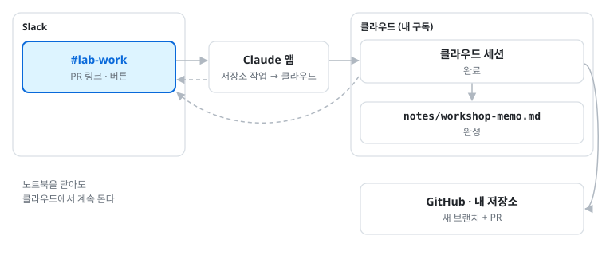
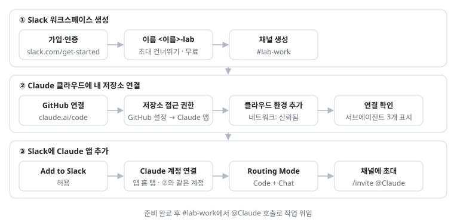

# 4. Slack 연결: 채널 대화 정리와 저장소 반영 · 선택

> 이 파일은 [워크숍 실습 가이드북](https://yoonlee78.github.io/ai-agent-workshop-2026/#4-slack) 4장과 같은 내용이다. 애니메이션과 최신 화면은 [웹 가이드북](https://yoonlee78.github.io/ai-agent-workshop-2026/#4-slack)에서 볼 수 있다. 원본: [GUIDE.md](../GUIDE.md#4-slack-연결-채널-대화-정리와-저장소-반영--선택)



*그림: Slack에서 @Claude에 작업 위임 · [애니메이션은 웹 가이드북에서 재생](https://yoonlee78.github.io/ai-agent-workshop-2026/#fig-slack-flow)*

**목표**: Slack 채널 메모의 정리와 저장소 반영(PR) 위임[^slackwhy]



*그림: Slack 연결 준비 순서 · 워크스페이스, 저장소 연결, Claude 앱*

링크: [워크스페이스 만들기](https://slack.com/get-started#/createnew) · [claude.ai/code](https://claude.ai/code) · [Slack용 Claude 앱](https://slack.com/marketplace/A08SF47R6P4)[^slacksteps][^ws]

`#lab-work`에 오늘 실습 메모를 올림. 예:

```text
1장 미팅 노트 스킬 완성. 미팅 메모 두 개로 시험함.
```

```text
2장 arXiv MCP 연결, 관련 논문 5편 확인.
```

```text
3장 서브에이전트 3개 생성, 핸드북 근거 답변 확인.
```

같은 채널에 보냄:

```text
@Claude ai-agent-workshop-2026 저장소에 이 채널에 올린 메모를 정리한 notes/workshop-memo.md를 새로 만들고 PR 올려줘. 한국어로 "진행 내용", "결과", "다음 단계" 세 절로 써줘. 다른 파일은 건드리지 말고, 중간에 묻지 말고 끝까지 해. 끝나면 PR 링크만 남겨줘.
```

Slack에서는 `@Claude`를 부를 때마다 새로 일을 시작한다. 고칠 말을 나중에 덧붙이면 처음부터 다시 하거나 같은 질문을 되풀이한다. 그래서 필요한 것을 **한 번에** 넣음.

| 프롬프트 요소 | 이유 |
| --- | --- |
| 저장소 이름 `ai-agent-workshop-2026` | 작업 저장소 지정 |
| 파일 경로와 세 절 | 결과 형식 지정 |
| "한국어로" | 작성 언어 재질문 방지 |
| "다른 파일은 건드리지 말고" | 수정 범위 제한 |
| "중간에 묻지 말고 끝까지 해" | 작업 중단 방지 |
| "PR 링크만 남겨줘" | 스레드 내 긴 출력 방지 |

**#lab-work**

```text
나: @Claude ai-agent-workshop-2026 저장소에 이 채널에 올린 메모를 정리한 notes/workshop-memo.md를 새로 만들고 PR 올려줘. … 끝나면 PR 링크만 남겨줘
Claude: ℹ️ Using the legacy Claude in Slack bot. …
Claude: Working in <내 계정>/ai-agent-workshop-2026 · PR 링크입니다: github.com/<내 계정>/ai-agent-workshop-2026/pull/1
Claude: [View session] [Create PR]
```

[^slackwhy]: Slack에서 시킨 일은 Anthropic 서버의 클라우드 세션에서 돌아 노트북을 닫아도 계속된다. 비용은 쓰던 Pro·Max 구독에서 나가고 API 키는 필요 없다. Team·Enterprise 계정은 이 절차를 적용할 수 없음.
[^slacksteps]: 자주 막히는 단계. ② 저장소 접근 허락: GitHub **Settings** → **Applications** → **Installed GitHub Apps** → **Claude** → **Configure** → **Only select repositories**에 `ai-agent-workshop-2026` 추가 → **Save**. claude.ai/code 저장소 목록에 내 저장소가 안 보이면 이 단계가 빠진 것이다. ② 연결 확인: 새 세션에 `이 저장소에서 쓸 수 있는 서브에이전트 이름만 알려줘. 파일은 바꾸지 마.`를 보내 세 담당 이름이 보이면 성공. ③ 앱 홈 탭의 **Connect to Slack MCP**는 2-3의 커넥터라 누르지 않음. **Routing Mode**는 ②를 마친 뒤에 보임.
[^ws]: 학교 Slack은 앱 설치 권한이 없는 경우가 많음. 게스트(외부 계정)가 있는 채널에서는 Claude가 "Claude doesn't respond in channels that include guests"라는 안내만 남길 수 있음. 그러면 게스트 없는 채널을 따로 만들어 씀.
