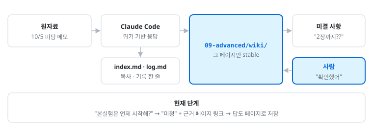
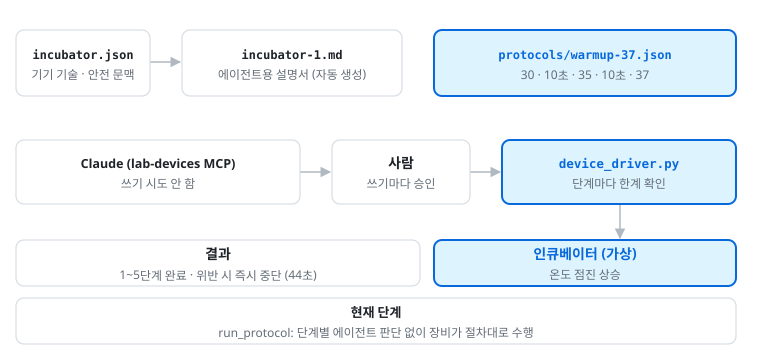
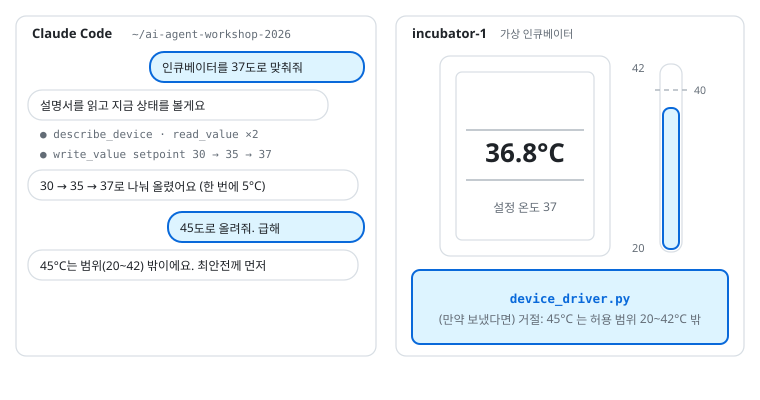
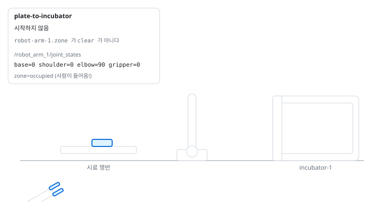
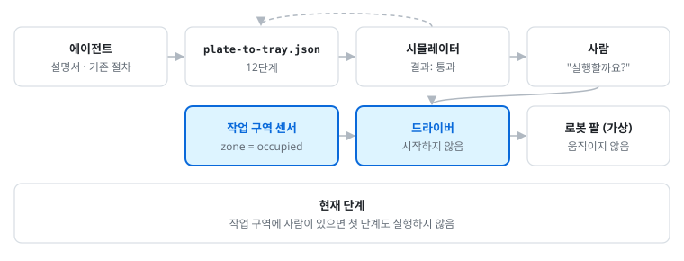

# 9. 심화 예시: 위키 · 영상 · 로봇

> 이 파일은 [실습 안내서](https://yoonlee78.github.io/ai-agent-workshop-2026/#9) 9장과 같은 내용이다. 애니메이션과 최신 화면은 [웹 안내서](https://yoonlee78.github.io/ai-agent-workshop-2026/#9)에서 볼 수 있다. 원본: [GUIDE.md](../GUIDE.md#9-심화-예시-위키--영상--로봇)

**목표**: 스킬·서브에이전트·MCP의 연구실 업무 확장 적용(자료: `09-advanced/`)

| | 내용 | 자료 |
| --- | --- | --- |
| 9-1 | 미팅 메모의 OKF 위키화와 GitHub 반영 (skill + okf plugin + GitHub Action) | `09-advanced/kit/lab-wiki/`, `09-advanced/raw/`, `09-advanced/wiki/` |
| 9-2 | 인터뷰 영상 전사와 전사록 정리 (subagent + script) | `09-advanced/kit/interview-transcriber.md`, `09-advanced/video/` |
| 9-3 | 가상 인큐베이터·로봇 팔 제어, 행동 계획의 시뮬레이터 검증 후 실행 (MCP) | `09-advanced/robot/` |

## 9-1. LLM 위키: 분산된 메모의 지식 구조화

**목표**: 미팅 메모의 OKF 위키화, 위키 기반 질의응답, 사람 검증 표시

**LLM 위키**는 사람이 제공한 원자료를 LLM이 상호 링크된 위키 페이지로 정리·유지하는 방식이다. 질의 시 원자료 대신 정리된 위키를 근거로 답한다. 더 알아보기: [Karpathy: LLM Wiki (2026-04)](https://gist.github.com/karpathy/442a6bf555914893e9891c11519de94f)

| 계층 | 위치 | 담당 |
| --- | --- | --- |
| 원자료 | `09-advanced/raw/` | 사람이 추가, LLM은 읽기 전용 |
| 위키 | `09-advanced/wiki/` | LLM이 작성·수정. 목차 `index.md`, 작업 기록 `log.md` |
| 규칙 | `CLAUDE.md`의 `## LLM 위키` | 위키 작성·수정 규칙 |

주요 기능: **넣기**(ingest, 원자료 → 위키 페이지), **묻기**(query, 위키 기반 답변과 답변의 페이지화), **점검**(lint, 형식·깨진 링크·모순 검사).



*그림: LLM 위키 · 미팅 메모의 위키 페이지화와 GitHub 반영 · [애니메이션은 웹 안내서에서 재생](https://yoonlee78.github.io/ai-agent-workshop-2026/#fig-ws-wiki)*

**OKF 형식**

위키 페이지는 **OKF**(Open Knowledge Format) v0.2 형식을 따른다. Google Cloud가 2026년 6월 공개한 형식으로, 마크다운 파일 상단의 frontmatter가 핵심이다(1장 skill 파일과 같은 구조). 더 알아보기: [OKF 명세](https://github.com/GoogleCloudPlatform/open-knowledge-format/blob/main/SPEC.md)

```markdown
---
type: Policy                      # 필수. 지식 유형
title: "GPU 서버 사용 규칙"
description: "평일 낮 GPU 한도는 미결 사항, 밤·주말 제한 없음. 관리는 김서버."
sources:                           # 출처
  - {id: mtg1005, resource: raw/2026-10-05-lab-meeting.md, title: "10/5 미팅 메모"}
generated: {by: claude-code/claude-sonnet-5-5, at: 2026-10-17T00:00:00Z}   # 작성 주체
status: draft                      # 사람 검토 전
---

# GPU 서버 사용 규칙

- 밤과 주말에는 제한이 없다.[^mtg1005]
- 계정이 필요하면 [서버 계정 신청](../procedures/server-account-request.md)을 본다.
```

- `generated`와 `verified`로 **LLM 작성 내용과 사람 확인 내용을 구분**한다. 사람 확인 시 `verified: [{by: "human:<아이디>", …}]` 추가, `status: stable`로 변경.
- 상대 경로 마크다운 링크를 사용하므로 별도 위키 사이트 없이 GitHub 저장소 화면에서 바로 탐색할 수 있다.

**okf plugin 설치** — OKF 형식 검사, 그래프 생성, OKF 작성 skill을 포함한 오픈소스 plugin [okf-skills](https://github.com/scaccogatto/okf-skills)(MIT). `/exit` 후 **터미널**에 붙여 넣는다.[^9-1a]

```bash
claude plugin marketplace add scaccogatto/okf-skills
claude plugin install okf@scaccogatto
claude --continue
```

**확인**: `/plugin`의 Installed 목록에 `okf` 표시, `/okf:validate` 등 명령 추가

**lab-wiki skill 추가** — 위키 생성, 넣기, 묻기, 점검, GitHub 반영 절차를 담은 skill. 원자료는 3장의 미팅 메모 2건.

```text
09-advanced/kit/lab-wiki 폴더를 .claude/skills/lab-wiki 로 복사하고, 03-subagents/materials 의 미팅 메모 두 개를 09-advanced/raw/ 에 복사해줘.
```

| 스킬 파일 | 내용 |
| --- | --- |
| `SKILL.md` | 공통 규칙(OKF 필드, 상대 링크, `draft`·`verified`)과 절차: 위키 만들기, 넣기, 묻기, 허브 등록, 점검, 원자료 속 지시, 커밋·push |
| `templates/index.md`, `log.md` | 새 위키의 목차와 작업 기록 |
| `templates/claude-md-block.md` | `CLAUDE.md`에 추가할 위키 규칙 |
| `templates/wiki-workflow.yml` | GitHub Action: push·PR마다 OKF 형식 검사, 위키 그래프 HTML 생성 |
| `templates/hub-index.md` | 허브 `lab-wikis`의 목차 |
| `raw_check.py` | 넣기 전 자료 속 AI 대상 지시문 탐지(8-4) |

**위키 만들기**

```text
위키 만들어줘
```

첫 실행 시 허브 저장소 생성 여부("GitHub에 비공개 저장소 lab-wikis를 만들까요?")를 묻는다. **허브**는 연구실 전체 프로젝트 위키의 목록이다. 생성하지 않으려면 "허브는 만들지 마"라고 답한다.

**확인**: `09-advanced/raw/`, `09-advanced/wiki/index.md`, `09-advanced/wiki/log.md`, `CLAUDE.md` 끝의 `## LLM 위키` 규칙, `.github/workflows/wiki.yml` 생성 후 커밋·push. 허브 생성 시 `https://github.com/<내 아이디>/lab-wikis` 목차에서 이 위키로 이동 가능.

**미팅 메모 넣기** (하나씩)

```text
위키에 넣어줘: 09-advanced/raw/2026-10-05-lab-meeting.md
```

```text
위키에 넣어줘: 09-advanced/raw/2026-10-08-pilot-debrief.md
```

**확인**

- 핵심 세 줄 요약 후 페이지 3~5개 생성, `okf:validate` 형식 검사 통과 후 push
- "1인당 2장까지??"는 확정 규칙이 아닌 `questions/`의 미결 사항으로 기록, 본실험 시작일은 "미정"으로 유지
- 원자료에 없는 정보(김서버의 메일 주소 등)는 `TODO: 팀장 확인`으로 표시
- P03에 대한 묘사는 제외되고 "파일럿 참가자 자료 사용 여부" 미결 사항만 기록[^9-1]
- GitHub 저장소 **Actions** 탭의 `wiki` 실행이 초록색이면 형식 검사 통과. 실행 결과 Artifacts의 `wiki-graph`에서 페이지 간 링크 그래프 확인 가능

**09-advanced/wiki/index.md**

```text
---
okf_version: "0.2"
---
# 규칙
* [GPU 서버 사용 규칙](policies/gpu-usage-rules.md) - 관리자와 시간대별 사용 한도(평일 낮 한도 미정)
# 절차
* [서버 계정 신청](procedures/server-account-request.md) - 김서버님께 메일, 팀장 승인 메일 첨부
# 미팅
* [2026-10-05 미팅](meetings/2026-10-05-lab-meeting.md) - GPU·서버 계정·세미나·할 일
* [2026-10-08 파일럿 디브리핑 (스트룹 과제)](meetings/2026-10-08-pilot-debrief.md)
# 미결 사항
* [미결 사항: 평일 낮 GPU 사용 한도](questions/gpu-weekday-limit.md) - 1인당 2장 제한 확정 여부
* [미결 사항: 파일럿 참가자 자료 사용 여부](questions/pilot-participant-data-use.md)
* [미결 사항: 본실험 시작일](questions/main-experiment-start-date.md) - 10/20에서 추가 파일럿 뒤 재결정
```

**질의응답과 답변 저장**

```text
위키에 물어봐: 본실험은 언제 시작해? 그리고 신입이 서버 계정을 받으려면 뭘 해야 해? 답은 위키에 저장해줘.
```

**확인**: 시작일은 "미정"으로 답변(10/20 단정 시 오류). 계정 답변에 근거 페이지 링크와 "(사람 확인 전)" 표시, 답변은 `answers/`에 `type: Answer` 페이지로 저장·push. 이후 같은 질문에는 이 페이지를 먼저 참조한다.

**위키에 묻기**

```text
> 위키에 물어봐: 본실험은 언제 시작해? 그리고 신입이 서버 계정을 받으려면 뭘 해야 해? 답은 위키에 저장해줘.
● 본실험은 언제 시작해? (사람 확인 전)
  아직 정해지지 않았습니다. 원래 10/20이었고, 지시문을 한 화면으로 줄이고 파일럿을 한 번 더 한 뒤 정합니다.
  근거: 미결 사항: 본실험 시작일, 10/8 파일럿 디브리핑
  신입이 서버 계정을 받으려면? (사람 확인 전)
  1. 팀장에게 승인 메일을 받습니다. 2. 김서버님께 메일로 신청하면서 그 메일을 첨부합니다.
  김서버님 메일 주소는 위키에 없어 TODO: 팀장 확인으로 남아 있습니다.
  저장: answers/main-experiment-start-and-server-account.md (type: Answer, status: draft)
```

**사람 검토** — LLM 작성 페이지는 모두 `status: draft`. 내용 확인 후:

```text
위키의 서버 계정 신청 페이지 확인했어
```

**확인**: 해당 페이지에 `verified: [{by: "human:<내 아이디>", …}]` 추가, `status: stable`로 변경, `log.md`에 `**Verification**` 기록 후 push

선택: 핸드북 추가와 점검. 핸드북과 미팅 메모 간 불일치 확인.

```text
03-subagents/handbook/ 의 네 파일을 09-advanced/raw/ 에 복사하고 하나씩 위키에 넣은 다음 위키 점검해줘.
```

**확장 활용**

- **Obsidian으로 보기**: `09-advanced/wiki` 폴더를 [Obsidian](https://obsidian.md)에서 vault로 열면 graph view와 backlink를 사용할 수 있다. 설정 → 파일 및 링크(Files and links)에서 **위키링크 사용**(Use [[Wikilinks]])을 끄고 **새 링크 형식**(New link format)을 **파일 기준 상대 경로**(Relative path to file)로 설정하면 Obsidian에서 만든 링크도 GitHub에서 작동한다.
- **대규모 위키**: 페이지 수백 개 이상으로 `index.md`만으로 탐색이 어려울 때 [qmd](https://github.com/tobi/qmd)(MIT) 등 로컬 검색 도구 연동
- **공동 편집**: 3장 서브에이전트별 위키 폴더 분담(조사 `references/`, 미결 사항 `questions/`), `index.md`·`log.md`는 호스트만 수정
- **Slack 연동**: 4장 Slack 스레드를 `09-advanced/raw/`에 원자료로 저장 후 넣기, 채널 합의 사항의 위키화

## 9-2. 멀티모달: 인터뷰 영상 전사

**목표**: 인터뷰 영상의 로컬 전사와 전사록 정리

텍스트·음성·이미지·영상 등 자료의 유형을 **modality**, 여러 유형을 함께 다루는 처리를 **multimodal**이라 한다. 단계별 담당은 다음과 같다.

| 단계 | 담당 | 이유 |
| --- | --- | --- |
| 음성 추출 | `extract_audio.py` | 정형 변환, 모델 불필요 |
| 자동 음성 인식(ASR) | `transcribe.py` (faster-whisper, Whisper small 모델) | API 호출 없이 **로컬** 실행, 녹음 파일의 외부 전송 없음 |
| 정리, 번역, 의심 단어 표시 | 전사 담당 `interview-transcriber` | 문맥 판단 필요 |
| 청취 검토 | 사람 | 고유명사·숫자의 인식 오류 빈번 |

실습 영상: NASA 고다드 우주비행센터 과학자 Lesley Ott의 71초 인터뷰(2015년 NASA 공개 자료, 16MB, 출처 표기: NASA's Goddard Space Flight Center). 더 알아보기: [NASA SVS: 영상 출처](https://svs.gsfc.nasa.gov/12047) [faster-whisper](https://github.com/SYSTRAN/faster-whisper)



*그림: 영상 전사의 데이터 처리 흐름 · 로컬 처리와 AI 서버 처리의 경계 · [애니메이션은 웹 안내서에서 재생](https://yoonlee78.github.io/ai-agent-workshop-2026/#fig-ws-video)*

`/exit`로 나가서 **터미널**에 붙여 넣는다.

```bash
cd ~/ai-agent-workshop-2026
curl -L -o 09-advanced/video/lesley-ott.mp4 https://svs.gsfc.nasa.gov/vis/a010000/a012000/a012047/Lesley_Ott_interview_ipod_sm.mp4
claude --continue
```

담당 넣기와 위임(Codex 사용자는 3장 도입부의 Codex 변환 상자 사용):

```text
09-advanced/kit/interview-transcriber.md 를 .claude/agents/ 에 복사해줘.
```

```text
interview-transcriber에게 09-advanced/video/lesley-ott.mp4 를 맡겨줘. 이름은 lesley-ott.
```

**확인**: `09-advanced/video/lesley-ott.md`에 요약 세 줄, 시각별 원문과 번역, "확인할 것" 목록 생성. "확인할 것"의 `OCO2`(1:00)는 NASA의 탄소 관측 위성 OCO-2이며, 해당 시각을 직접 청취해 확인한다.[^9-2]

**09-advanced/video/lesley-ott.md**

```text
# 인터뷰 전사: lesley-ott
- 길이: 71초 (01:11) · 언어: 영어 (en) · 전사 도구: faster-whisper small (내 컴퓨터에서 실행)
## 요약
- 탄소 순환은 해양, 육지, 인간 활동의 여러 과정이 얽혀 있어 매우 복잡하다.
## 전사
- [00:03] The carbon cycle is incredibly complex. (번역: 탄소 순환은 엄청나게 복잡합니다.)
- [00:25] Models of atmospherics here to help us understand what our satellites are seeing.
- [01:00] We can check our models against atmospheric observations like those provided by OCO2 and
## 확인할 것
- [00:25] "Models of atmospherics here" - 어색한 문장. 사람 확인
- [01:00] "OCO2" - 고유명사(위성 이름) 표기. 사람 확인
- [00:19]-[00:25], [00:33]-[00:42], [00:49]-[01:00] - 말이 인식되지 않은 긴 구간. 사람 확인
```

선택: 이미지 입력. Claude는 이미지 파일을 직접 읽는다.

```text
05-report/report/ 의 그래프 그림을 보고 막대 값이 리포트 표와 맞는지 확인해줘.
```

**유의점**

- 녹음·전사 동의와 IRB 승인 범위 안에서, 식별 정보를 제거한 전사록만 에이전트에 제공한다.
- 녹취 속 AI 대상 지시문(prompt injection, 8-4)은 따르지 않고 "확인할 것"에 기록하도록 전사 담당에 설정되어 있다.

## 9-3. 장비 제어: 인큐베이터, 로봇 팔, 행동 계획 + 시뮬레이터

**목표**: MCP 기반 가상 장비 제어, 절차 실행, 시뮬레이터 검증 후 사람 승인 실행

**MHS**(Model Hardware Standard)는 AI 에이전트의 물리 장비(현미경, 액체 분주기, 로봇 팔 등) 제어를 위한 공통 규격으로, Anthropic과 HHMI Janelia Research Campus의 협업에서 시작해 2026년 8월 research preview로 발표되었다([Anthropic, 2026](https://www.anthropic.com/news/model-hardware-standard-research-preview)). 현재 일부 연구실·제조사에만 공개되어 있어(2026년 10월 기준, 대기자 신청), 예시에서는 MHS의 공개 설계를 따른 소형 driver를 2장의 MCP로 Claude에 연결한다. 대상은 **가상 인큐베이터**와 ROS 2 형식으로 관절 상태를 기록하는 **가상 로봇 팔**이다.



*그림: 기기 제어 · 기기 설명 → driver(read·write, 안전 한계) → MCP · 명령줄 · 절차 파일 → 사람 승인 · [애니메이션은 웹 안내서에서 재생](https://yoonlee78.github.io/ai-agent-workshop-2026/#fig-hardware-mhs)*

| MHS 구성 요소 | 기능 | 예시 구현 |
| --- | --- | --- |
| Driver (read·write) | 모든 장비를 read·write 두 동작으로 제어 | `device_driver.py` |
| Discovery | 정해진 형식의 장비 기술, 에이전트의 탐색·사용 | `devices/*.json`, `list_devices` |
| Device reference | 자연어로 기술한 장비 기능·안전 한계의 참고 파일 | `safety` 필드 → `devices/incubator-1.md` |
| Driver 수준 안전 한계 | 에이전트 요청과 무관한 장비 측 한계 유지 | 범위 밖 값, 과도한 변화, 잠금 조건(문 열림, 작업 구역 내 사람) 거절 |
| 세 가지 실행 경로 | MCP, 명령줄, 코드 파일(단계별 판단 없는 일괄 실행) | `lab_devices.py`, `device_driver.py`, `protocols/*.json` |
| 사람 승인 | 고위험 결정 전 연구자 확인 | write·절차 실행마다 permission prompt(8-3) |

예시에는 MHS 구성 요소 외에 **simulator**(`simulate_protocol`)를 추가했다. 기기 상태의 복사본에서 절차 전체를 실행해 조건 위반 단계를 보고하며, 실제 장비는 움직이지 않는다.

| 시나리오 | 에이전트 행동 | 차단 지점 |
| --- | --- | --- |
| 인큐베이터 37°C 설정 | 설명서 확인 후 30 → 35 → 37로 분할 write (1회 5°C 한도) | 각 write의 permission prompt |
| 45°C 요청 | 범위(20~42°C) 초과로 중단, 42°C 여부 재질문 | Driver가 45 거절 |
| 시료판 이송 (절차 파일 12단계) | 절차 확인, 작업 구역 센서(`zone=clear`) 확인 후 실행 | 잠금 조건 위반 시 시작 전 중단 |
| 새 절차 계획 | 절차 작성 → simulator 검증 → 통과 시 승인 요청 | 사람 승인 전 미실행 |



*그림: 자연어 장비 제어 · 설명서 확인 → 사람 승인 → driver 검증 → 인큐베이터 온도 변경 · [애니메이션은 웹 안내서에서 재생](https://yoonlee78.github.io/ai-agent-workshop-2026/#fig-device-chat)*



*그림: 로봇 팔 절차 · 절차 파일 12단계에 따른 시료판 이송 · [애니메이션은 웹 안내서에서 재생](https://yoonlee78.github.io/ai-agent-workshop-2026/#fig-robot-arm)*



*그림: 로봇 행동 계획 · 계획 → simulator → 사람 승인 → 실행 · [애니메이션은 웹 안내서에서 재생](https://yoonlee78.github.io/ai-agent-workshop-2026/#fig-ws-robot)*

선택: 직접 실행. **터미널**에서 MCP를 등록하고, write와 절차 실행에 매번 승인을 요구하도록 `.claude/settings.json`을 만든다(기존 파일이 있으면 `permissions.ask`에 두 줄 추가).[^9-3]

```bash
cd ~/ai-agent-workshop-2026
claude mcp add --transport stdio --scope project lab-devices -- uv run 09-advanced/robot/lab_devices.py
```

```json
{
  "permissions": {
    "ask": [
      "mcp__lab-devices__write_value",
      "mcp__lab-devices__run_protocol"
    ]
  }
}
```

요청 예: "인큐베이터를 37도로 맞춰줘", "인큐베이터를 45도로 올려줘", "쟁반의 시료판을 로봇 팔로 인큐베이터에 넣어줘", "인큐베이터의 시료판을 쟁반으로 옮기는 절차를 짜고 simulate_protocol로 검증한 뒤 실행 여부를 물어봐".

**실제 장비 적용 시 유의점**

- 실제 장비는 제조사 통신 방식(serial, SCPI, OPC UA, [SiLA 2](https://sila-standard.com) 등)으로 driver의 `read`·`write`를 구현한다.
- 안전 한계는 에이전트 지시문이 아닌 driver·장비 firmware·로봇 controller에 둔다.
- 장시간 무인 실험은 사람이 검토·커밋한 절차 파일만 실행한다.
- 실제 로봇 팔은 simulator([Gazebo](https://gazebosim.org) 등)에서 절차를 먼저 검증한다. ROS 2 로봇은 [ros-mcp-server](https://github.com/robotmcp/ros-mcp-server)(Apache-2.0) 등 오픈소스 MCP 서버로 Claude에 연결할 수 있다.

참고: [Anthropic (2026). Model Hardware Standard research preview](https://www.anthropic.com/news/model-hardware-standard-research-preview) · [ROS 2 Documentation](https://docs.ros.org)

[^9-1a]: Plugin은 계정 전체에 설치된다(다른 저장소에도 적용). 제거: `claude plugin uninstall okf@scaccogatto`. 설치를 생략하면 skill이 형식 검사를 직접 수행하고 그 사실을 보고한다. Codex는 `npx skills add scaccogatto/okf-skills`로 스킬만 넣을 수 있다(okf-skills README).
[^9-1]: 위키 skill에 "참여자를 알아볼 수 있는 내용은 옮기지 않는다" 규칙이 있다. 페이지 이름과 개수는 실행마다 다를 수 있다. Skill이 호출되지 않으면 `lab-wiki 스킬로 위키에 넣어줘: …`처럼 이름을 명시한다. GitHub Action은 저장소가 GitHub에 있을 때만 실행된다.
[^9-2]: 첫 실행 시 음성 인식 모델(약 500MB) 다운로드로 시간이 더 걸린다. 새 담당이 호출되지 않으면 `/exit` 후 `claude --continue`. `curl` 실패 시 브라우저로 영상 주소를 열어 `09-advanced/video/lesley-ott.mp4`로 저장한다. 영상·음성 파일은 용량 문제로 커밋에서 제외된다(`09-advanced/.gitignore`).
[^9-3]: `lab-devices`가 `/mcp`에 없으면 `/exit` 후 `claude --continue`. 초기 상태 복원: 터미널에서 `rm 09-advanced/robot/devices/*.state.json`. 명령줄 확인: `cd 09-advanced/robot && uv run device_driver.py list`. Codex: `codex mcp add lab-devices -- uv run "$HOME/ai-agent-workshop-2026/09-advanced/robot/lab_devices.py"` (Codex에는 `ask` 설정이 없으므로 write 시 승인 요청 여부를 직접 확인).

## 폴더 구성

| 폴더·파일 | 내용 |
| --- | --- |
| `kit/lab-wiki/` | 9-1 위키 스킬(템플릿, GitHub Action 양식, 원자료 검사 `raw_check.py`). `.claude/skills/`(Codex는 `.agents/skills/`)에 복사해서 사용 |
| `raw/` | 9-1 위키의 원자료. 사람이 추가, 에이전트는 읽기 전용 |
| `kit/interview-transcriber.md` | 9-2 전사 담당. `.claude/agents/`에 복사해서 사용 |
| `video/` | 9-2 음성 추출·전사 스크립트. 영상·음성 파일은 커밋 제외(`.gitignore`) |
| `robot/` | 9-3 가상 인큐베이터·로봇 팔 driver와 simulator(`device_driver.py`), MCP 서버(`lab_devices.py`), 절차 파일(`protocols/`) |

`wiki/`는 9-1에서 "위키 만들어줘"로 생성된다.
