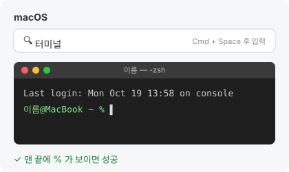
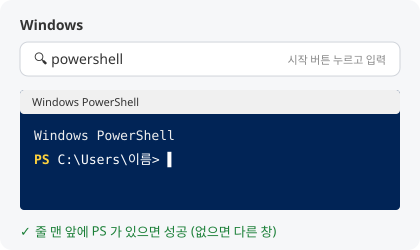

# ai-agent-workshop-2026

Hands-on workshop: build your own research assistant with Claude Code (skills, MCP, subagents)

**📘 워크숍 실습 가이드북**

- 웹 (GitHub Pages): https://yoonlee78.github.io/ai-agent-workshop-2026/
- 웹 (Claude 아티팩트): https://claude.ai/artifact/CfSokAX6ddWyTPduiry3bv
- 저장소 파일: [GUIDE.md](GUIDE.md) · 장별 내용은 각 장 폴더의 README

받은 저장소에서 에이전트 대화창(Claude Code·Codex)에 아래를 붙여 넣으면 가이드북이 브라우저로 열린다.

```text
GUIDE.html을 브라우저로 열어줘
```

## 수업 전 준비

워크숍 당일 바로 실습할 수 있도록, 수업 전에 설치와 환경 점검을 마침.

강의와 실습은 주로 **Claude Code**와 **[Orca](https://github.com/stablyai/orca)**(여러 코딩 에이전트를 한 화면에서 쓰는 데스크톱 앱)로 진행한다. 튜토리얼은 Codex 등 다른 모델로도 따라 할 수 있게 만들어 두었다.

### 🗺️ 한눈에 보기

| 단계 | 할 일 | 누가 |
| :---: | --- | --- |
| 📦 | [준비물](#-준비물-3가지-모두-필수) 챙기기: GitHub 계정, AI 코딩 도구 구독 | 나 |
| **1** | [터미널 열기](#1-터미널-열기) | 나 |
| **2** | [AI 코딩 도구 설치·로그인](#2-ai-코딩-도구-설치로그인) | 나 |
| **3** | [나머지는 에이전트에게 맡기기](#3-나머지는-에이전트에게-맡기기) | 🤖 에이전트 |
| ✅ | [설치 실습 준비 완료!](#-여기까지-했다면-설치-실습-준비-완료) | |

막히면 → [❓ 자주 묻는 질문](#-자주-묻는-질문-qa)

---

### 📦 준비물 (3가지 모두 필수)

**① GitHub 계정**

1. 없으면 [github.com/signup](https://github.com/signup)에서 만들기
2. 이메일 인증까지 마치기

**② AI 코딩 도구** (실습은 **Claude Code**를 기준으로 진행한다)

| 도구 | 필요한 것 |
| --- | --- |
| Claude Code (기준) | Claude **Pro 이상** 구독 (Pro로 충분함) |
| Codex | 개인 계정 또는 서울대 재학생 `snu.ac.kr` 계정 (학생용 계정은 일부 기능이 제한될 수 있음) |
| Claude Code + OpenRouter | 구독 없이 쓴 만큼 결제 (5장까지 모두 실습하면 $5 정도 예상). 설정은 [GUIDE.md 부록 B](GUIDE.md#부록-b--claude-구독-없이-하기-codex--openrouter) |

Codex로 하는 사람은 GUIDE.md 0장 끝의 **Claude Code · Codex 대응표**를, OpenRouter로 하는 사람은 [GUIDE.md 부록 B](GUIDE.md#부록-b--claude-구독-없이-하기-codex--openrouter)를 참고함.

> [!WARNING]
> **무료 플랜은 안 됨.** Claude 무료 플랜은 Claude Code에 로그인이 안 되고, 다른 개인 무료 플랜은 실습 도중 사용량 한도에 걸려 멈춤.

**③ 내 노트북** (macOS 또는 Windows)

---

### 1. 터미널 열기

| | macOS | Windows |
| --- | --- | --- |
| **여는 법** | `Cmd` + `Space` → **터미널** 입력 | 시작 → **powershell** 입력 → **Windows PowerShell** |
| **성공 화면** | `이름@컴퓨터 ~ %` | `PS C:\Users\이름>` (앞에 **PS** 필수) |

<p>


</p>

> [!TIP]
> **꼭 기억할 두 가지**
> 1. 무언가를 설치한 뒤에는 터미널을 **완전히 닫고 새로 열기**
> 2. 실행 중인 명령을 멈추려면 `Ctrl` + `C`

---

### 2. AI 코딩 도구 설치·로그인

Claude Code와 Codex 중 **쓸 것 하나 이상**을 설치함. 둘 다 설치해도 괜찮음.

> [!NOTE]
> 아래의 명령은 모두 **1번에서 연 터미널**(macOS 터미널 / Windows PowerShell)에 복사해 붙여 넣고 `Enter`를 눌러 실행함.

#### 2-0. Git 설치 (🪟 Windows만)

Windows의 Claude Code는 Git이 있어야 동작한다. macOS는 이 단계를 건너뜀 (나중에 3번에서 자동으로 설치된다).

```powershell
winget install --id Git.Git -e
```

<br>

#### 2-1. Claude Code

**① 설치**: 터미널에 내 운영체제 쪽 명령을 붙여 넣고 `Enter` (코드 오른쪽 위 복사 버튼을 쓰면 편함)

🍎 macOS 터미널

```bash
curl -fsSL https://claude.ai/install.sh | bash
```

🪟 Windows PowerShell (관리자 권한 필요 없음)

```powershell
irm https://claude.ai/install.ps1 | iex
```

**② 로그인**

1. 새 터미널을 열고 `claude` 입력
2. 브라우저가 열리면 claude.ai 로그인 → **승인**
3. "Do you trust the files in this folder?" → **Yes**
4. "API 키를 쓸까요?" → **거절** (API 요금이 따로 나감)

<br>

#### 2-2. Codex

**① 설치**: 터미널에 내 운영체제 쪽 명령을 붙여 넣고 `Enter`

🍎 macOS 터미널 (Homebrew가 없으면 [Q&A](#macos-homebrew-등)의 Homebrew 설치부터)

```bash
brew install --cask codex
```

🪟 Windows PowerShell (Node.js가 없으면 먼저 `winget install --id OpenJS.NodeJS.LTS -e` 실행 후 새 창)

```powershell
npm install -g @openai/codex
```

**② 로그인**

1. 새 터미널을 열고 `codex` 입력
2. **Sign in with ChatGPT** 선택
3. 개인 계정 또는 서울대 `snu.ac.kr` 계정으로 로그인

<br>

#### 2-3. 확인

- `안녕`이라고 입력해서 답이 오면 성공 ✅
- 나가기: Claude Code는 `/exit`, Codex는 `/quit`

<br>

#### 2-4. Orca (선택)

**Orca는 무엇인가?** 여러 AI 코딩 도구(Claude Code, Codex 등)를 한 화면에서 쓰게 해 주는 데스크톱 앱이다. 강의 화면은 Orca로 보여 준다. 없어도 터미널만으로 실습할 수 있음.

**① 내 컴퓨터에 맞는 파일 받기** (누르면 바로 다운로드됨)

| 내 컴퓨터 | 받을 파일 |
| --- | --- |
| 🍎 Mac, Apple 칩 (M1·M2·M3·M4) | [orca-macos-arm64.dmg](https://github.com/stablyai/orca/releases/latest/download/orca-macos-arm64.dmg) |
| 🍎 Mac, Intel 칩 | [orca-macos-x64.dmg](https://github.com/stablyai/orca/releases/latest/download/orca-macos-x64.dmg) |
| 🪟 Windows | [orca-windows-setup.exe](https://github.com/stablyai/orca/releases/latest/download/orca-windows-setup.exe) |

> [!TIP]
> **Mac 칩 확인**: 화면 왼쪽 위  → **이 Mac에 관하여** → "칩"에 Apple M…이면 Apple 칩, "프로세서"에 Intel이면 Intel 칩

**② 설치**

- 🍎 macOS: 받은 `.dmg`를 열고 Orca 아이콘을 **Applications(응용 프로그램)** 폴더로 끌어다 놓기
- 🪟 Windows: 받은 `.exe`를 실행. "Windows의 PC 보호" 창이 뜨면 **추가 정보** → **실행**

**③ 실행**: Orca를 열면 2-1·2-2에서 로그인한 Claude Code·Codex 계정을 그대로 쓴다. 따로 가입할 필요는 없음.

---

### 3. 나머지는 에이전트에게 맡기기

Claude Code 또는 Codex 창에 아래 내용을 통째로 붙여 넣음. 에이전트가 GitHub 연결부터 마지막 점검까지 한 단계씩 설명하고 확인받으면서 대신 진행한다. 직접 해야 하는 일(GitHub 로그인, 이름·이메일 입력, 설치 허락)은 에이전트가 물어볼 때 답하면 됨.

```text
워크숍 수업 전 준비를 도와줘. 나는 터미널이 처음인 초보자야.
순서대로, 한 단계씩 나에게 설명하고 확인받으면서 해줘. 에러가 나면 원인을 쉬운 말로 설명하고 고쳐줘.

1) 도구 점검·설치: git, gh(GitHub CLI), Node.js(v22 이상), uv가 있는지 확인하고, 없는 것만 허락받고 설치해.
   macOS: git이 없으면 xcode-select --install. 나머지는 brew로. brew가 없으면 Homebrew 설치를 안내하고,
   설치 끝의 Next steps 명령까지 실행하게 해. 관리자 권한이 없어 brew가 안 되면 brew 없이 설치하는 방법으로 해.
   Windows: winget으로 설치해. 명령은 &&로 잇지 말고 한 줄씩 실행해.
   새로 설치한 도구를 못 찾으면, 내가 새 터미널에서 너를 다시 열고 이 프롬프트를 다시 붙여 넣을게.
2) GitHub 로그인: gh auth status 로 확인해. 로그인이 안 되어 있거나 Token scopes에 repo가 없으면 네가 대신 하지 말고,
   내가 새 터미널 창에서 직접 실행할
   gh auth login --hostname github.com --git-protocol https --web
   명령과 화면에서 할 일을 알려줘. 토큰은 만들지 않을 거야. 내가 "로그인했어"라고 하면 다시 확인하고 gh auth setup-git 을 실행해.
3) git 이름·이메일: git config --global user.name / user.email 이 비어 있으면 나에게 물어보고 설정해.
4) 실습 저장소 받기: gh repo clone yoonlee78/ai-agent-workshop-2026 ~/ai-agent-workshop-2026
   안 되면 원인을 쉬운 말로 알려 주고, 인터넷 연결과 gh auth status 를 다시 확인해.
5) push 테스트: 홈 폴더에 gh-test 폴더를 만들고 README.md 하나를 커밋한 뒤
   gh repo create gh-test --private --source . --push 로 올려. 같은 이름이 있으면 gh-test2 처럼 바꿔.
   성공하면 저장소 주소를 보여 주고, GitHub에서 지우는 방법(Settings → Delete this repository)을 알려 준 뒤 내 컴퓨터의 gh-test 폴더는 지워.
6) 그래프 도구 미리 받기: 수업 5장에서 그래프를 그릴 때 기다리지 않도록 아래를 한 번 실행해. 마지막에 ok가 나오면 돼.
   uv run --with pandas --with matplotlib python -c "import pandas, matplotlib.pyplot; print('ok')"
7) 마지막 점검: git --version, node --version, gh --version, uvx --version, claude --version, codex --version,
   gh auth status, git config user.name, git config user.email 을 실행하고 항목별 통과/실패 표로 보여줘.
   6번에서 ok가 나왔는지도 표에 넣어. claude와 codex는 하나만 있어도 통과야. gh repo view ai-agent-workshop-2026 으로 내 계정에 같은 이름 저장소가 아직 없는지도 확인해 줘(수업 중에 만들어).
```

> [!IMPORTANT]
> **확인**: 에이전트가 마지막에 보여 준 표가 모두 통과함.


<br>

<div align="center">

# ✅ 여기까지 했다면 설치 실습 준비 완료!

수업 당일 실습 시작 🎉

</div>

<br>

---
---

<br>

## 🛠️ 참고: 직접 설치하기

> [!NOTE]
> **3번까지 했다면 이 부분은 하지 않아도 됨.** 에이전트가 아래 A~E를 대신 해 줬다.
> 에이전트 없이 직접 하고 싶거나, 에이전트가 중간에 막혔을 때만 찾아봄.

<details>
<summary><b>A. 도구 설치</b></summary>

3번 프롬프트 없이 직접 설치하려면 E 점검표의 "실패하면" 칸 명령을 하나씩 실행함. 설치가 끝나면 새 터미널을 엶.

</details>

<details>
<summary><b>B. 터미널과 GitHub 연결</b></summary>

GitHub 계정이 이미 있어도 터미널에서 따로 연결해야 수업 중에 저장소를 만들고 올릴 수 있다.

새 터미널에서 직접 실행함.

```bash
gh auth login --hostname github.com --git-protocol https --web
```

- 화면에 나온 8자리 코드를 복사 → Enter → 열린 브라우저에 붙여 넣기 → **Authorize**
- "Authenticate Git with your GitHub credentials?"를 물으면 **Y**
- 이어서 `gh auth setup-git`도 실행함.

처음 git을 쓰는 컴퓨터라면 커밋에 남길 이름과 이메일도 정함. GitHub 가입 이메일을 쓰면 됨.

```bash
git config --global user.name "내 이름"
git config --global user.email "GitHub 가입 이메일"
```

</details>

<details>
<summary><b>C. 실습 저장소 받기</b></summary>

```bash
gh repo clone yoonlee78/ai-agent-workshop-2026 ~/ai-agent-workshop-2026
```

`Could not resolve to a Repository`가 나오면 주소에 오타가 없는지 확인함. 그래도 안 되면 강사·실습 조교에게 알림.

</details>

<details>
<summary><b>D. 저장소 만들고 올리기 테스트</b></summary>

수업 중에 하는 "저장소 만들기 → 커밋 → GitHub에 올리기"를 미리 한 번 해 봄. 한 줄씩 붙여 넣음 (macOS·Windows 공통).

```bash
cd ~
mkdir gh-test
cd gh-test
git init
echo test > README.md
git add README.md
git commit -m "test"
gh repo create gh-test --private --source . --push
```

**확인**: 마지막에 `https://github.com/<아이디>/gh-test` 주소가 나오고, 브라우저에서 열었을 때 README.md가 보이면 성공임.

테스트가 끝나면 지움.

- GitHub: 브라우저에서 `gh-test` 저장소 → **Settings** → 맨 아래 **Delete this repository**
- 내 컴퓨터: `cd ~` 후 macOS `rm -rf gh-test`, Windows `Remove-Item -Recurse -Force gh-test`

</details>

<details>
<summary><b>E. 환경 점검</b></summary>

새 터미널에 붙여 넣음.

```bash
git --version; node --version; gh --version; uvx --version; claude --version; codex --version; gh auth status; git config user.name; git config user.email
```

| 항목 | 통과 기준 | 실패하면 |
| --- | --- | --- |
| Git | `git version 2.x` | macOS `xcode-select --install`, Windows `winget install --id Git.Git -e` |
| Node.js | `v22` 이상 | macOS `brew install node`, Windows `winget install --id OpenJS.NodeJS.LTS -e` |
| GitHub CLI | `gh version 2.x` | macOS `brew install gh`, Windows `winget install --id GitHub.cli -e` |
| uv | `uvx 0.x` | macOS `curl -LsSf https://astral.sh/uv/install.sh \| sh`, Windows `powershell -ExecutionPolicy ByPass -c "irm https://astral.sh/uv/install.ps1 \| iex"` |
| Claude Code / Codex | `2.x (Claude Code)` 또는 `codex-cli 0.x` (쓰는 것 하나 이상) | 2번 설치 명령 |
| GitHub 로그인 | `Logged in to github.com account <아이디>`, `Token scopes`에 `'repo'` 포함 | B 다시 |
| git 이름·이메일 | 마지막 두 줄에 이름과 이메일이 나옴 | B의 `git config` 두 줄 |

쓰지 않는 도구(예: Codex)는 `not found`가 나와도 괜찮음.

수업 5장에서 쓸 그래프 도구도 미리 받아 둠. 마지막에 `ok`가 나오면 통과임.

```bash
uv run --with pandas --with matplotlib python -c "import pandas, matplotlib.pyplot; print('ok')"
```

**확인**

- [ ] 점검 항목이 모두 통과함 (Claude Code·Codex는 쓰는 것만)
- [ ] `~/ai-agent-workshop-2026` 폴더가 있음
- [ ] D 테스트 저장소가 GitHub에 올라감 (확인 후 지움)
- [ ] 그래프 도구 명령에서 `ok`가 나옴
- [ ] 내 GitHub 계정에 `ai-agent-workshop-2026` 저장소가 **아직 없음** (수업 중에 만듦)

</details>

---

## ❓ 자주 묻는 질문 (Q&A)

에러가 나면 먼저 여기를 찾아봄. 없으면 에러 문구를 통째로 Claude Code나 Codex에 붙여 넣고 "초보자인데 어떻게 해?"라고 물어봄. 그래도 해결되지 않으면 강사·실습 조교에게 편하게 연락함.

### 공통

**Q. 설치했는데 `command not found` / `인식되지 않습니다`가 나옴.**
A. 터미널을 완전히 닫고(macOS는 `Cmd` + `Q`) 새로 엶. 그래도 안 되면 컴퓨터를 재시작함.

**Q. 비밀번호를 치는데 화면에 아무것도 안 보임.**
A. 정상이다. 컴퓨터 로그인 비밀번호를 입력하고 Enter를 누름.

**Q. 설치가 중간에 멈춰 있음.**
A. 학교 와이파이에서 자주 생긴다. `Ctrl` + `C`로 멈추고 휴대폰 핫스팟으로 바꿔서 다시 해 봄.

---

### Claude Code · Codex

**Q. Claude Code 로그인이 안 되거나 구독이 필요하다는 메시지가 나옴.**
A. Claude 무료 플랜으로는 Claude Code를 쓸 수 없음. Pro 이상을 구독하거나 Codex(개인 계정 또는 `snu.ac.kr` 계정) 또는 OpenRouter를 씀. 구독 상태는 claude.ai 왼쪽 아래 이름 → 설정에서 확인할 수 있음.

**Q. 로그인할 때 "API 키를 쓸까요?"라고 물음.**
A. 거절함. API 키로 쓰면 구독과 별도로 요금이 나감.

**Q. `claude`를 실행했는데 브라우저가 안 열림.**
A. 터미널에 나온 주소를 복사해 브라우저에 직접 붙여 넣음.

**Q. macOS에서 설치는 끝났는데 계속 `claude: command not found`가 나옴.**
A. 아래 두 줄을 실행하고 새 터미널을 엶.

```bash
echo 'export PATH="$HOME/.local/bin:$PATH"' >> ~/.zshrc
source ~/.zshrc
```

**Q. 실습 중에 "usage limit" / 사용량 한도 메시지가 나옴.**
A. 무료 플랜이거나 한도를 다 쓴 경우다. 안내된 시간이 지나면 다시 쓸 수 있다. 수업 중이라면 다른 도구(Claude Code ↔ Codex)로 바꿔서 이어 감.

---

### GitHub 연결

**Q. GitHub 계정이 없음.**
A. [github.com/signup](https://github.com/signup)에서 만들고 이메일 인증까지 마침.

**Q. `gh auth login`을 했는데 브라우저가 안 열림.**
A. 브라우저에서 [github.com/login/device](https://github.com/login/device)를 직접 열고 터미널에 나온 8자리 코드를 입력함.

**Q. 브라우저에서 Authorize를 눌렀는데 터미널이 그대로임.**
A. 터미널 창을 한 번 클릭하고 Enter를 누름. 그래도 그대로면 `Ctrl` + `C`로 멈추고 `gh auth login ...`부터 다시 함.

**Q. `gh auth status`에 `You are not logged into any GitHub hosts`가 나옴.**
A. B의 `gh auth login` 명령을 다시 실행함.

**Q. 다른 GitHub 계정으로 로그인되어 있음.**
A. `gh auth logout`으로 로그아웃한 뒤 B를 다시 함.

**Q. `Token scopes`에 `'repo'`가 없음.**
A. `gh auth refresh -s repo`를 실행하고 브라우저에서 다시 승인함.

**Q. push할 때 Username과 Password를 물음.**
A. GitHub는 비밀번호로 push할 수 없음. `Ctrl` + `C`로 멈추고 `gh auth setup-git`을 실행한 뒤 다시 함.

**Q. push할 때 `Permission denied` / `403` 에러가 남.**
A. 예전에 다른 계정 정보가 컴퓨터에 저장되어 있는 경우가 많다. `gh auth setup-git`을 실행한 뒤 다시 함. 그래도 안 되면 저장된 정보를 지움.
- macOS: **키체인 접근** 앱 → `github.com` 검색 → 항목 삭제
- Windows: **자격 증명 관리자** → Windows 자격 증명 → `git:https://github.com` 삭제

**Q. `Permission denied (publickey)`가 나옴.**
A. SSH 방식으로 연결되어 있는 경우다. 아래를 실행한 뒤 B를 다시 함.

```bash
gh config set git_protocol https
```

**Q. `Please tell me who you are`가 나옴.**
A. git에 이름과 이메일이 없어서 그렇다. B의 `git config` 두 줄을 실행함.

**Q. push할 때 `GH007: Your push would publish a private email address`가 나옴.**
A. GitHub에서 이메일 비공개 설정을 켜 둔 경우다. GitHub **Settings → Emails**에 나온 `숫자+아이디@users.noreply.github.com` 주소를 복사해서 아래처럼 바꾼 뒤, 커밋을 다시 만듦.

```bash
git config --global user.email "숫자+아이디@users.noreply.github.com"
git commit --amend --reset-author --no-edit
```

**Q. 저장소를 만들 때 `Name already exists on this account`가 나옴.**
A. 같은 이름의 저장소가 이미 있다. D 테스트라면 `gh-test2`처럼, 수업 중 1-1이라면 `ai-agent-workshop-2026-1019`처럼 다른 이름을 쓰면 됨.

**Q. 저장소를 받을 때 `Could not resolve to a Repository`가 나옴.**
A. 저장소 주소에 오타가 있거나 GitHub 로그인이 안 된 경우다. `gh auth status`로 로그인을 확인하고, C의 명령을 복사 버튼으로 다시 붙여 넣음.

---

### macOS (Homebrew 등)

**Q. `brew: command not found`가 나옴.**
A. Homebrew가 없는 경우다. 아래 명령으로 설치함. 중간에 컴퓨터 비밀번호를 묻고, Enter를 눌러 계속하라고 하면 Enter를 누름.

```bash
/bin/bash -c "$(curl -fsSL https://raw.githubusercontent.com/Homebrew/install/HEAD/install.sh)"
```

설치 끝에 나오는 **Next steps** 아래 명령(보통 `echo ... >> ~/.zprofile`과 `eval ...` 두 줄)을 꼭 그대로 복사해 실행하고, 새 터미널을 엶.

**Q. Homebrew를 설치했는데도 `brew: command not found`가 나옴.**
A. Next steps 줄을 실행하지 않은 경우다. 아래를 실행하고 새 터미널을 엶 (M1·M2·M3 등 Apple 칩 Mac 기준).

```bash
echo 'eval "$(/opt/homebrew/bin/brew shellenv)"' >> ~/.zprofile
eval "$(/opt/homebrew/bin/brew shellenv)"
```

**Q. Homebrew 설치 중 관리자 권한이 없다는 메시지가 나옴.**
A. 연구실 공용 컴퓨터처럼 관리자 계정이 아닌 경우다. Homebrew 없이 진행하면 됨. 3번 프롬프트를 Claude Code나 Codex에 붙여 넣으면 brew 없이 설치하는 방법으로 진행한다. Node.js는 [nodejs.org](https://nodejs.org)에서 LTS 설치 파일을 받아도 됨.

**Q. `xcrun: error: invalid active developer path`가 나옴.**
A. macOS를 업데이트한 뒤 자주 나온다. `xcode-select --install`을 실행하고, 뜨는 창에서 **설치**를 누름.

**Q. `xcode-select --install`에서 "이미 설치되어 있다"는 메시지가 나옴.**
A. 이미 준비된 상태다. 다음 단계로 넘어감.

---

### Windows

**Q. `'irm' is not recognized` / `'curl' is not recognized`가 나옴.**
A. PowerShell이 아니라 명령 프롬프트(CMD)에서 실행한 경우다. 시작 → **Windows PowerShell**을 열고, 앞에 `PS`가 보이는지 확인한 뒤 다시 함.

**Q. `이 시스템에서 스크립트를 실행할 수 없으므로`가 나옴.**
A. 아래를 실행하고 `Y`를 누른 뒤 다시 함.

```powershell
Set-ExecutionPolicy -Scope CurrentUser RemoteSigned
```

**Q. `winget`을 찾을 수 없다는 메시지가 나옴.**
A. Microsoft Store에서 **앱 설치 관리자**(App Installer)를 설치하거나 업데이트한 뒤 PowerShell을 새로 엶.

**Q. Claude Code가 Git(Git Bash)이 필요하다고 함.**
A. `winget install --id Git.Git -e`로 Git을 설치하고 PowerShell을 새로 연 뒤 `claude`를 다시 실행함.

**Q. `npm`을 찾을 수 없다는 메시지가 나옴 (Codex 설치 중).**
A. Node.js가 없는 경우다. `winget install --id OpenJS.NodeJS.LTS -e`로 설치하고 PowerShell을 새로 엶.

**Q. `&&`가 올바른 구분 기호가 아니라는 메시지가 나옴.**
A. Windows PowerShell은 `&&`를 지원하지 않음. 명령을 한 줄씩 나눠서 붙여 넣음.

**Q. Windows 사용자 이름이 한글임 (예: `C:\Users\홍길동`).**
A. 대부분 문제없지만, 일부 도구가 한글 경로에서 에러를 낼 수 있음. 설명하기 어려운 에러가 나면 사용자 이름이 한글이라는 점과 함께 강사·실습 조교에게 알림.
